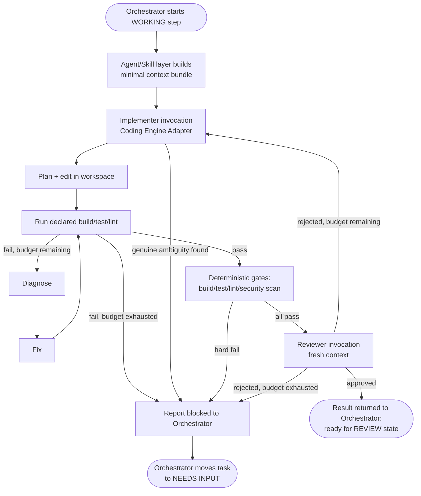

# Agent Architecture

This document answers the question the vision document is explicit about: **multi-agent is not assumed to be better** — every agent role below had to earn its place. It also defines the coding-engine abstraction and the self-fix loop.

## Is the orchestrator itself an "agent"?

No. The **Task Orchestrator** is a deterministic workflow/state machine (see [TASK_LIFECYCLE.md](./TASK_LIFECYCLE.md)): it decides *which step runs next* based on explicit rules and gate results, not by reasoning over free text. Keeping it deterministic is what makes tasks resumable, auditable, and cheap — it makes zero LLM calls of its own. Intelligence is confined to a small number of well-scoped agent invocations it calls out to.

## Which agent roles actually earn their place

The brief lists candidate responsibilities: Orchestrator, Planner, Repository/Context Analyst, Coding Agent, Test Agent, Review Agent, Security/Quality Agent, Deployment Agent. Evaluated one by one:

| Candidate | Decision | Why |
|---|---|---|
| Orchestrator | **Not an LLM agent** — a workflow engine. | Determinism, resumability, auditability, zero token cost for control flow. |
| Planner | **Folded into the Implementer invocation.** | Modern coding engines (Claude Code included) already explore the repo and plan internally before editing. A separate Planner agent would re-read the same repository a second time to produce a plan the Implementer re-reads anyway — pure token waste for no reliability gain. Reconsider only if a future need (e.g. cross-repo/cross-project planning) requires reasoning the Implementer's single-repo context can't do. |
| Repository/Context Analyst | **Not a separate agent.** | Same reasoning as Planner: the Implementer's own repo exploration, seeded with the project's structured context files, covers this. See [CONTEXT_ARCHITECTURE.md](./CONTEXT_ARCHITECTURE.md). |
| Coding Agent | **Yes — "Implementer" role.** | This is the actual work: plan → edit → run tests → diagnose → fix, looped, inside the workspace, via the Coding Engine abstraction. |
| Test Agent | **Not an LLM agent — a deterministic tool step.** | Running the project's declared build/test/lint commands and parsing structured output needs no model call. The Implementer invokes this as a tool during its self-fix loop; the Orchestrator invokes it again independently as a gate (see below) so results aren't only self-reported. |
| Review Agent | **Yes — "Reviewer" role, in a fresh context.** | This is the one place a second model invocation earns real reliability: an agent that did *not* write the diff, reviewing it against the task, test results, and static/security findings, and that cannot mark the task done itself. Independent judgment is the whole point — reusing the Implementer's own context would just reproduce its blind spots. |
| Security/Quality Agent | **Not a separate agent for MVP — deterministic tool gates**, folded into validation. | Static analysis / security scanning tools produce structured findings without needing a model. Findings are handed to the Reviewer as input rather than requiring a third LLM pass. Revisit if a project needs judgment-heavy security review a scanner can't provide. |
| Deployment Agent | **Not an agent — a deterministic adapter call** behind explicit human approval. | Triggering/polling CI/CD is I/O, not reasoning. See [INTEGRATION_ARCHITECTURE.md](./INTEGRATION_ARCHITECTURE.md). |

**Net result: two agent roles (Implementer, Reviewer), invoked by a non-LLM orchestrator, wrapped around deterministic tool gates.** This is the simplest design that still gets independent verification — the specific thing the vision document asks for ("reliability from multiple independent verification and quality gates," not from trusting one model).

## Coding Engine abstraction

Both agent roles run through the same narrow interface so the underlying tool is swappable:

```
CodingEngineAdapter
  run(role: "implementer" | "reviewer", contextBundle, workspaceHandle) -> StepResult

StepResult
  summary, filesChanged[], diffRef, confidence, findings[], status: "completed" | "blocked" | "needsInput"
```

- **Implementer** invocation: given the task context bundle and a writable workspace, it plans, edits, and runs the project's test/build commands as tools, iterating until it either produces a result it's confident in or exhausts its budget (see Self-Fix Loop below). It reports `needsInput` if it hits genuine ambiguity it cannot resolve from the repo.
- **Reviewer** invocation: given the diff, the Implementer's summary, and validation output — but a *fresh* context, not the Implementer's transcript — it evaluates whether the change actually satisfies the task and flags concerns. It cannot set task status to done; it only returns a verdict the Orchestrator applies. A "changes requested" verdict does not fail the task — it triggers a bounded review/fix cycle (same two roles, same workspace/branch, no new agent involved) that hands the Reviewer's findings back to the Implementer as structured feedback and re-runs validation/commit/push before the Reviewer looks again. See [TASK_LIFECYCLE.md](./TASK_LIFECYCLE.md) "Review/fix cycle" for the full loop and its bound.

The platform ships `OpenCodeAdapter` (`opencode`, preferred default for MVP) and `ClaudeCodeAdapter` (`claude-code`), plus `FixtureCodingEngine` (`fixture`) for tests. Additional adapters implement the same interface; adapter choice is project configuration (`Project.codingEngine`), never a platform-core decision. See [CODING_ENGINE.md](./CODING_ENGINE.md) and [INTEGRATION_ARCHITECTURE.md](./INTEGRATION_ARCHITECTURE.md).

## Self-fix loop

Owned by the Agent Runtime around a single Implementer invocation (not by the Orchestrator, and not requiring a human prompt of "test failed, fix it"):

```
implement -> run declared tests/build -> pass? -> done
                                       -> fail? -> diagnose -> fix -> re-test
```

Bounded by configurable limits (max iterations, max wall-clock time, max cost) set per project/tenant. Exceeding the budget is not a silent failure — it moves the task to `NEEDS INPUT` with the failure history attached, per [TASK_LIFECYCLE.md](./TASK_LIFECYCLE.md). This loop runs entirely inside one Implementer invocation's session — it doesn't create new agent invocations per retry.

## Diagram C — Agent execution flow



## Why this stays simple as the platform grows

- New capability needs (e.g. a dedicated performance-review pass) are added as a new **role** on the same `CodingEngineAdapter` interface and a new gate in project config — not a new service or a redesign of the Orchestrator.
- Token/cost growth is bounded because only two roles ever run per iteration, each with a freshly-built minimal context (see [CONTEXT_ARCHITECTURE.md](./CONTEXT_ARCHITECTURE.md)), not an ever-growing shared transcript.
- Reliability comes from the Reviewer being structurally independent (fresh context, cannot self-approve) plus deterministic gates — not from adding more agents.
