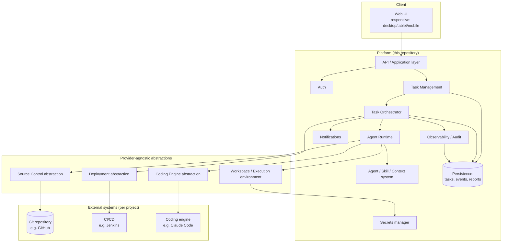

# Architecture

This document defines the system's layers, their responsibilities/boundaries, and the key design decisions behind the shape of the system. Companion documents go deeper on specific slices: [AGENT_ARCHITECTURE.md](./AGENT_ARCHITECTURE.md) (agent/orchestration design), [TASK_LIFECYCLE.md](./TASK_LIFECYCLE.md) (state machine), [INTEGRATION_ARCHITECTURE.md](./INTEGRATION_ARCHITECTURE.md) (adapters), [SECURITY_ARCHITECTURE.md](./SECURITY_ARCHITECTURE.md), [CONTEXT_ARCHITECTURE.md](./CONTEXT_ARCHITECTURE.md).

## Design questions answered up front

These decisions shape every layer below; rationale is inline, deeper treatment is in the linked doc.

| Question | Decision |
|---|---|
| One orchestrator or many agents? | One orchestrator (deterministic workflow/state machine, not an LLM) per task, delegating to a small number of agent *roles* only where independent judgment adds value. See [AGENT_ARCHITECTURE.md](./AGENT_ARCHITECTURE.md). |
| Sync or async execution? | Task creation is synchronous (fast API call). All execution (investigate → implement → test → fix → validate) is asynchronous background work. |
| Long-running tasks? | Modeled as durable, persisted state machines. A task survives process restarts; it resumes from its last persisted state, not from in-memory agent state. |
| Multiple projects running independently? | Each task executes in its own isolated, ephemeral workspace (container + git worktree/clone). No shared mutable checkout per project. |
| Multiple concurrent tasks? | Each task is an independent job on a queue; a worker pool executes jobs with configurable per-project concurrency limits to bound resource use and avoid two tasks racing on the same branch. |
| Task state persistence? | Relational store is the system of record: task, task event log (append-only), and task artifacts (diffs, reports). The coding engine's own transcript is not the source of truth. |
| Recovery from failure/restart? | Workspaces are disposable and reproducible from git; task state is reproducible from the event log. A crashed worker's task is re-queued and resumes from last persisted checkpoint. |
| How does an agent retain context? | Structured **task record** (goal, plan, discovered constraints, decisions, human answers) persisted in the DB, not a growing chat transcript. Each coding-engine invocation is given a fresh, minimal prompt built from this record. See [CONTEXT_ARCHITECTURE.md](./CONTEXT_ARCHITECTURE.md). |
| How do we minimize token usage? | Project context lives in the project's own repo (CLAUDE.md/AGENTS.md-style files) and is discovered by the coding engine itself, not concatenated by the platform. The platform passes pointers and short structured summaries, not raw repository content. |
| How are tools exposed to agents? | The coding engine (e.g. Claude Code) uses its own native tool system inside the sandboxed workspace. The platform does not reimplement file/edit/test tools — it configures the environment and supplies task context. |
| How do coding agents execute safely? | Inside an isolated, resource-limited container per task, with scoped short-lived credentials and a constrained command/network policy. See [SECURITY_ARCHITECTURE.md](./SECURITY_ARCHITECTURE.md). |
| How are repository workspaces isolated? | One ephemeral workspace per task (fresh clone/worktree at a commit, dedicated branch), torn down after task completion. |
| How are tests detected/run across arbitrary stacks? | Declared per project as commands (build/test/lint) in project config, not hardcoded per language. If undeclared, the coding engine determines them once and the result is cached into project context. |
| How are review gates implemented? | A mix of deterministic tool gates (build, test, lint, security scan) plus one independent reviewer invocation of a coding engine, in a fresh context, that cannot mark its own work "done." |
| How does human input resume a task? | `NEEDS INPUT` is a first-class task state with a structured question record; an answer is an event that re-enqueues the task with the answer folded into the next invocation's context. |
| How are Git operations abstracted? | A narrow `SourceControlProvider` interface (clone, branch, commit, push, open PR, get status) implemented first for GitHub. |
| How will Jenkins/AWS/etc. integrate later? | Behind a `DeploymentAdapter` interface (`trigger`, `getStatus`, `rollback`), selected per project, never referenced by name in core logic. |
| How do we avoid provider lock-in? | Every external dependency (coding engine, source control, deployment, secrets) sits behind a narrow interface owned by the platform core; concrete providers are swappable implementations selected via project/tenant config. |
| How does this become multi-tenant later? | `tenant_id`/`project_id`/`user_id` are in the data model from day one; MVP runs single-tenant but the schema and auth boundary don't need to be redesigned to add tenants. |
| What's in the MVP vs. not? | See [MVP_SCOPE.md](./MVP_SCOPE.md). |

## Layers

Each layer is described as: responsibility, inputs, outputs, dependencies, extensibility point.

### 1. Web UI
- **Responsibility**: project list, Kanban task board, task detail/report view, NEEDS INPUT answer form, auth screens. Responsive single web app.
- **Inputs**: user actions; task/report data from the API layer.
- **Outputs**: task creation requests, human-input answers, deployment approvals.
- **Depends on**: API/Application layer only (no direct access to persistence, workspaces, or providers).
- **Extensibility**: new views can be added without touching orchestration; the UI never encodes project-specific or coding-engine-specific logic.

### 2. API / Application layer
- **Responsibility**: the platform's public contract — project/task CRUD, task-event queries, human-input submission, auth session handling. Translates HTTP requests into orchestrator commands/events; translates persisted state into UI-consumable views.
- **Inputs**: authenticated HTTP requests.
- **Outputs**: persisted commands/events; API responses.
- **Depends on**: Auth, Task Management, Persistence.
- **Extensibility**: versioned API; new endpoints for new capabilities (e.g. deployment approval) added without breaking existing clients.
- **Implemented (Step 3)**: `src/api/` (Express, see [TECHNICAL_DECISIONS.md](./TECHNICAL_DECISIONS.md) TD-17) is a thin HTTP layer over `src/application/` (`ProjectService`, `TaskService`, `HumanInputService` — see TD-16 on why this process never itself calls the Orchestrator). Full endpoint/DTO contract in [API.md](./API.md). Runs as its own process (`npm run api`), separate from the worker that actually drives execution (`npm run worker`) — see layer 6 below.

### 3. Authentication / Authorization
- **Responsibility**: identify the user; authorize actions against a project (membership-based in MVP; role-based later).
- **Implemented (Step 6)**: real server-side sessions (HttpOnly cookie, `crypto.scrypt` password hashing) and ownership-based authorization (`User -> owns -> Project -> tasks`), enforced in the application layer on every request — see [AUTHENTICATION.md](./AUTHENTICATION.md). The Step 3 placeholder this replaced (TD-19) predicted the swap would touch one middleware file without changing application services or routes' shape; it mostly held — the middleware file changed, and application services gained explicit ownership checks (a real authorization rule that didn't exist to enforce before), but the Orchestrator and domain layer needed no changes at all.
- **Inputs**: credentials/session tokens.
- **Outputs**: authenticated identity + permitted actions.
- **Depends on**: Persistence (users, project membership).
- **Extensibility**: pluggable identity provider (local auth first, SSO/OAuth later); `tenant_id` present from day one for future org-level isolation.

### 4. Task Management
- **Responsibility**: owns the task/project/report domain model; the developer-facing unit of work.
- **Inputs**: task creation requests, human answers, orchestrator status updates.
- **Outputs**: task state, task event timeline, reports.
- **Depends on**: Persistence, Task Orchestrator (emits commands to it, consumes its events).
- **Extensibility**: task schema is project/stack-agnostic; all technology-specific detail lives in the task's linked project config, not in the task schema.

### 5. Task Orchestrator
- **Responsibility**: drives a single task through its lifecycle state machine ([TASK_LIFECYCLE.md](./TASK_LIFECYCLE.md)); decides which step runs next, applies quality gates, decides when to pause for human input, and resumes tasks on answer. This is the "brain" of execution control, but it is a deterministic workflow engine, not itself an LLM call.
- **Inputs**: task record, project config, events (step completed, test result, human answer).
- **Outputs**: commands to the Agent Runtime ("run implementer", "run reviewer"), state transitions, persisted events.
- **Depends on**: Agent Runtime, Persistence, Context layer.
- **Extensibility**: gate composition (which validation stages apply) is project-configurable; new gate types can be added without changing the state machine shape.
- **Implemented**: `src/orchestrator/orchestrator.ts` (Step 2). Invoked exclusively by `src/worker/worker.ts` (Step 3) — a polling loop that lists claimable `TODO`/`WORKING` tasks and calls `executeTask()` for each, reusing the atomic claim from TD-12 as the only authority over who executes what, bounded by `WORKER_MAX_CONCURRENT_TASKS` (default 2 real executions in flight at once per worker process — see [TASK_LIFECYCLE.md](./TASK_LIFECYCLE.md) "Worker concurrency and lease loss"). The API layer never calls it directly (TD-16). A task only becomes a claimable `TODO` candidate after a separate, earlier, human-driven step: every task is created into `BACKLOG` (not `TODO`), and only an explicit developer "Start Task" action (`Orchestrator.startTask`, gated on that task's explicit dependencies) releases it into `TODO` — the worker itself never sees or touches `BACKLOG` tasks. See [TASK_LIFECYCLE.md](./TASK_LIFECYCLE.md) "Task creation," "BACKLOG editing," and "Task dependencies."

### 6. Agent Runtime
- **Responsibility**: executes one orchestrator-requested step by invoking a Coding Engine Adapter inside a prepared Workspace, streaming back progress/results. Owns the self-fix loop (implement → test → diagnose → fix → re-test) up to a configured resource/attempt budget.
- **Inputs**: step request (role: implementer/reviewer), task context bundle, workspace handle.
- **Outputs**: step result (diff, logs, test outcomes, structured findings), progress events.
- **Depends on**: Coding Engine abstraction, Repository abstraction, Workspace/Execution environment.
- **Extensibility**: new agent roles (e.g. a future security-specialist pass) are added as new step types, not new services.
- **Cancellation (Step 5)**: every step is given the same `AbortSignal` for the duration of one WORKING episode; a lightweight in-process watcher (`Orchestrator.withCancellation`) polls the persisted cancellation intent and aborts it — this is what actually interrupts a running child process, not the cancellation request itself. See [TASK_LIFECYCLE.md](./TASK_LIFECYCLE.md) "Cancellation" and TECHNICAL_DECISIONS.md TD-26.

### 7. Agent / Skill system
- **Responsibility**: supplies each agent invocation with the minimal relevant context and capability set — project instruction files, task record summary, relevant skills — instead of raw repository dumps.
- **Inputs**: project context files (in-repo), platform-level instruction files, task record.
- **Outputs**: a scoped prompt/context bundle per invocation.
- **Depends on**: Context Architecture ([CONTEXT_ARCHITECTURE.md](./CONTEXT_ARCHITECTURE.md)).
- **Extensibility**: new skills/context files are additive; discovery is hierarchical so unrelated projects never pay the token cost of each other's context.

### 8. Coding Engine abstraction
- **Responsibility**: a narrow interface (`plan/implement`, `review`) that any coding agent/tool can implement.
- **Inputs**: context bundle, workspace path, role (implementer/reviewer).
- **Outputs**: file changes committed in the workspace, structured result (summary, confidence, files touched).
- **Depends on**: concrete adapter (Claude Code first).
- **Extensibility**: additional adapters (OpenCode, Cursor CLI, others) implement the same interface; selection is per-project config. See [INTEGRATION_ARCHITECTURE.md](./INTEGRATION_ARCHITECTURE.md).
- **Cancellation contract (Step 5)**: `run()` takes an `AbortSignal`; on abort an adapter must gracefully terminate its child process (SIGTERM, bounded grace period, then SIGKILL) and reject with `EngineCancelledError`, never resolve normally or leave the process running. See `src/coding-engine/coding-engine.ts` and TECHNICAL_DECISIONS.md TD-26.

### 9. Repository abstraction
- **Responsibility**: source-control operations the platform itself performs (as opposed to the coding engine's local `git` usage inside the sandbox): clone, branch, commit visibility, push, open PR, read status checks.
- **Inputs**: repository reference, credentials handle (scoped).
- **Outputs**: branch/PR state.
- **Depends on**: `SourceControlProvider` implementation (GitHub first).
- **Extensibility**: GitLab/Bitbucket implement the same interface later.

### 10. Workspace / Execution environment
- **Responsibility**: provisions an isolated, ephemeral environment per task (container, checked-out repo, injected scoped credentials, resource limits) and tears it down after use.
- **Inputs**: repository reference + commit/branch, project's declared environment (build image / setup commands).
- **Outputs**: a working directory the Coding Engine Adapter can read/write, plus command-execution results.
- **Depends on**: container runtime, Secrets layer.
- **Extensibility**: execution backend (local Docker now; remote sandboxes/cloud runners later) is swappable without changing the Agent Runtime contract.

### 11. Testing / Validation
- **Responsibility**: runs the project's declared build/test/lint commands inside the workspace and produces structured, machine-readable results.
- **Inputs**: project-declared commands, workspace state.
- **Outputs**: pass/fail + structured output (counts, failures) feeding both the self-fix loop and the report.
- **Depends on**: Workspace/Execution environment.
- **Extensibility**: stack-agnostic by construction — the platform never special-cases a test framework.

### 12. Review / Quality gates
- **Responsibility**: independent verification that does not trust the implementer's self-report — deterministic gates (build/test/lint/security-scan results) plus a fresh-context reviewer invocation of a coding engine that evaluates the diff and validation output and can reject it.
- **Inputs**: diff, validation results, project quality-gate config.
- **Outputs**: gate verdicts feeding the orchestrator's decision to move to `REVIEW`/`DONE` or back to `WORKING`/`NEEDS INPUT`.
- **Depends on**: Agent Runtime (for the reviewer invocation), Testing/Validation.
- **Extensibility**: gate set is project-configurable (e.g. a project can require a security scan; another may not have one available).

### 13. Deployment abstraction
- **Responsibility**: triggers and verifies deployment through a provider-agnostic interface, gated by explicit human approval.
- **Inputs**: approved task/branch, target environment.
- **Outputs**: deployment status, verification result.
- **Depends on**: `DeploymentAdapter` implementation (Jenkins first; interface only may ship before a working implementation — see [MVP_SCOPE.md](./MVP_SCOPE.md)).
- **Extensibility**: GitHub Actions/AWS/others implement the same interface later.

### 14. Notifications
- **Responsibility**: tells a developer a task needs attention (reached `NEEDS INPUT`, `REVIEW`, or failed) without requiring them to poll the board.
- **Inputs**: task state-transition events.
- **Outputs**: in-app notification (MVP); email/Slack/etc. are later channels behind the same event.
- **Depends on**: Task Management event stream.
- **Extensibility**: new channels subscribe to the same event stream; no coupling to orchestration internals.

### 15. Persistence
- **Responsibility**: system of record for users, projects, tasks, task events (append-only), reports, and provider credential *references* (not secret values).
- **Inputs/Outputs**: reads/writes from all layers above via the Task Management/API layer — not accessed directly by the Agent Runtime or Coding Engine.
- **Depends on**: relational database — SQLite for the MVP, see [TECHNICAL_DECISIONS.md](./TECHNICAL_DECISIONS.md) TD-11 for why and the migration path to Postgres.
- **Extensibility**: schema includes `tenant_id` from the start; task/event tables are the durable backbone recovery relies on.

### 16. Observability / Audit
- **Responsibility**: append-only, queryable record of every task state transition and agent action (what ran, what changed, what gate decided what) for debugging and trust.
- **Inputs**: events emitted by the Orchestrator and Agent Runtime.
- **Outputs**: the task event timeline shown in "View Details"; logs/metrics for operators.
- **Depends on**: the same event log used for recovery (§ Persistence) — audit is a read view over it, not a separate system, in MVP.
- **Extensibility**: can be exported to a dedicated observability stack later without changing what gets recorded.

### 17. Secrets / Security
- **Responsibility**: stores and issues scoped, short-lived credentials (repo access, deployment tokens) to workspaces at execution time; never exposes raw secrets to prompts, logs, or source files.
- **Inputs**: credential requests scoped to a task/workspace.
- **Outputs**: short-lived, narrowly-scoped tokens injected at runtime.
- **Depends on**: a secrets manager (see [SECURITY_ARCHITECTURE.md](./SECURITY_ARCHITECTURE.md) for MVP vs. future choice).
- **Extensibility**: designed so the same mechanism scales from one operator's local secrets to per-tenant secret isolation.

## Diagram A — High-level system architecture

## Diagram G reference

See [CONTEXT_ARCHITECTURE.md](./CONTEXT_ARCHITECTURE.md) for the Context/Skill diagram. Task lifecycle, agent execution flow, and human-intervention diagrams live in [TASK_LIFECYCLE.md](./TASK_LIFECYCLE.md) and [AGENT_ARCHITECTURE.md](./AGENT_ARCHITECTURE.md) to keep each concern in one place.
