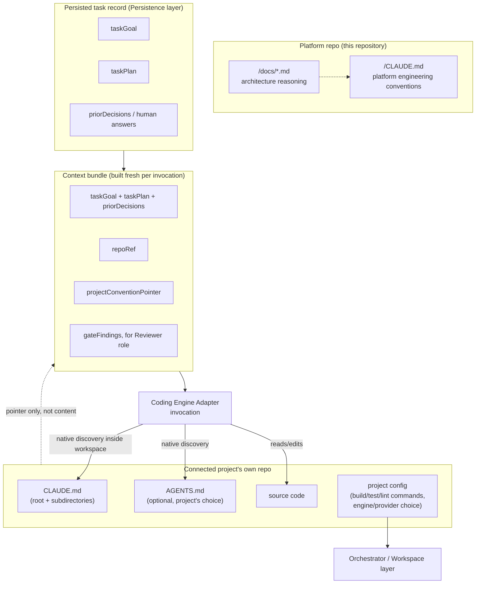

# Context Architecture

Token efficiency and "the system should not repeatedly ask what it can determine itself" both come down to the same design problem: **where does context live, and how does an agent invocation get only the part it needs.** This document defines that, and resolves which instruction files exist and why.

## The core rule: Platform context and Project context never mix

- **Platform-level context** describes how to work on *this repository* — the platform product itself. It lives at the root of this repo, in `/CLAUDE.md`.
- **Project-level context** describes how to work on a *connected project's* codebase (OTT, E-True, XYZ, ...). It lives **inside that project's own repository**, version-controlled with that project, not inside the platform repo. The platform never stores a copy of a project's coding conventions, architecture notes, or test instructions in its own database or repo — it points at them.

This is the direct implementation of the Platform-vs-Project separation in [PRODUCT_VISION.md](./PRODUCT_VISION.md).

## Why context lives in the project's repo, not the platform's database

1. **It's already version-controlled and reviewable** the same way the code it describes is — a PR that changes a testing convention updates the instructions in the same commit.
2. **It's naturally scoped** — an Implementer invocation working on OTT never has E-True's context in its window, because it's simply not present in OTT's checkout.
3. **The coding engine already knows how to find it.** Tools like Claude Code natively discover hierarchical instruction files (`CLAUDE.md` at various directory levels) as part of normal repo exploration. The platform does not need to build its own retrieval system — it configures where the engine starts and lets the engine's native discovery do the rest. This is the direct answer to "the system should not repeatedly send the entire repository/context to the AI": nothing is *sent* proactively; the engine reads what it needs, when it needs it, the same way a human developer opens the file they care about instead of reading the whole repo top to bottom.

## What the platform *does* supply per invocation (the token-efficient part)

Not the repository. Not a prior transcript. A small, purpose-built **context bundle**, assembled fresh for each Implementer/Reviewer invocation from the persisted task record (see [TASK_LIFECYCLE.md](./TASK_LIFECYCLE.md)):

```
ContextBundle
  taskGoal                 # the original plain-language description
  taskPlan                 # persisted after first Implementer invocation, reused not re-derived
  priorDecisions[]          # human answers already given, discovered constraints
  repoRef                  # repo url, branch, commit
  projectConventionPointer # e.g. "see CLAUDE.md" — not its contents
  latestDiffState          # if resuming mid-task
  gateFindings[]            # for the Reviewer role only: what the deterministic gates found
```

This bundle is what bounds token growth on long-running or resumed tasks: a task that pauses at `NEEDS INPUT` and resumes a day later does not replay its entire history — the next invocation gets the task record's current state plus the new answer, exactly like handing a fresh engineer a well-written ticket instead of a chat log.

## File hierarchy: which instruction files exist, and where

| File | Lives in | Loaded by | Purpose |
|---|---|---|---|
| `/CLAUDE.md` (this repo, root) | Platform repo | Any coding engine (human or automated) working **on the platform itself** | Platform engineering conventions — how to build/test/run *this* product. Not read by task-execution agents working on connected projects. |
| `CLAUDE.md` (project repo, root and/or subdirectories) | Each connected project's own repo | The Coding Engine Adapter, natively, while executing a task **against that project** | Project overview, architecture, conventions, test/build commands, known constraints — exactly the content listed in the brief (§18–19). Owned and maintained by that project's team, like any other file in their repo. |
| `AGENTS.md` (project repo, optional) | A connected project's own repo, only if that project's maintainers choose to add it | Coding engines that follow the `AGENTS.md` convention | An **optional, per-project** file for engine-specific or agent-specific operating instructions that don't belong in the human-facing `CLAUDE.md`. Not created by the platform automatically — a project adopts it the same way it adopts any convention. |
| `/AGENTS.md` (platform repo root) | **Not created.** | — | No second coding-engine-facing instruction file is needed at the platform's own root: this repository is operated through Claude Code, so `/CLAUDE.md` alone is sufficient and authoritative. Creating a duplicate would only create a synchronization burden. Revisit only if a second, materially different coding engine starts operating on the *platform's own* codebase. |
| Project metadata/config (e.g. `.platform/project.yml`, or an equivalent declared in project settings) | Either the project repo (versioned) or the platform's project settings, per project preference | The Orchestrator/Workspace layer | *Non-narrative* facts the orchestrator needs mechanically: build/test/lint commands, coding-engine choice, source-control provider, deployment target. Distinct from `CLAUDE.md`, which is narrative/human-readable context for the agent, not machine config for the orchestrator. |

**Precedence when both exist**: within a project's own repo, more specific (deeper-directory) `CLAUDE.md` files take precedence for that subtree, per the coding engine's own native hierarchy — the platform does not reimplement or override this. Platform-level `/CLAUDE.md` and a project's `CLAUDE.md` never compete for precedence because they are never loaded into the same invocation: platform `CLAUDE.md` governs work *on the platform repo*; project `CLAUDE.md` governs work *inside that project's workspace* during task execution.

## Duplication avoidance

- The platform's task-record schema stores *pointers* (repo, branch, commit, path hints) — never a copy of project documentation.
- If the Implementer discovers project-specific facts not yet documented (e.g. "tests are run via `make test`, not `npm test`"), the recommended pattern is for it to propose an update to the project's own `CLAUDE.md` as part of its normal PR — keeping the single source of truth in the project repo rather than growing a shadow copy inside the platform's database.
- Platform-level engineering conventions (this repo) and product/architecture docs (`/docs/*`, this document set) are two different things: `/CLAUDE.md` is operating instructions for whoever/whatever codes *on* the platform; `/docs/*` is the reasoning behind the design. `/CLAUDE.md` should stay short and link into `/docs/*` rather than duplicating it.

## Diagram G — Context / skill architecture



## Summary answer to "which files, and why"

- Platform gets exactly one instruction file: `/CLAUDE.md`. No `/AGENTS.md` at platform root — unjustified duplication for a single-engine-operated repo.
- Each connected project owns its own `CLAUDE.md` (required convention for the platform to be useful there) and may optionally add `AGENTS.md` — the platform doesn't create or manage these; it only reads/points at them.
- `/docs/*.md` (this document set) is platform product/architecture documentation — a third category, for humans and for whoever builds the platform, not loaded into task-execution context at all.
