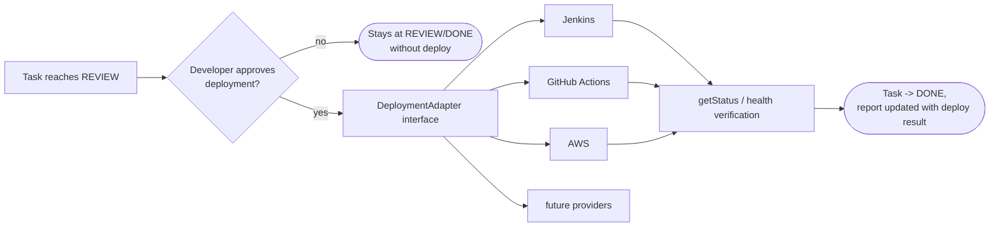
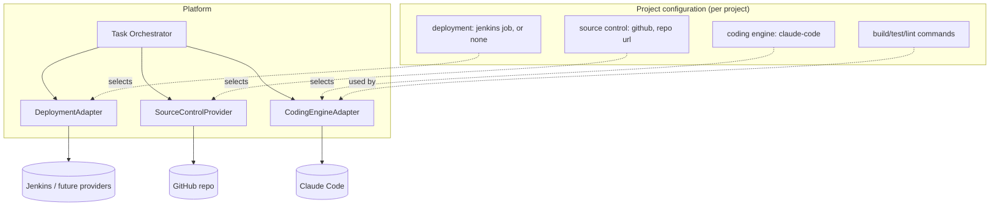

# Integration Architecture

The platform depends on three categories of external system — coding engines, source control, and deployment/CI-CD — plus secrets. Every one sits behind a narrow interface owned by the platform core; no core logic references a specific provider by name. This document defines those interfaces and the MVP implementations.

## Why interfaces, not direct integrations

Section 10/14/15/17 of the product brief are explicit: none of Claude Code, GitHub, or Jenkins may become a hard dependency. Concretely this means:
- Core orchestration code calls `CodingEngineAdapter`, `SourceControlProvider`, `DeploymentAdapter` — never a vendor SDK directly.
- Provider selection is **project configuration** (which engine, which SCM, which CI/CD), resolved at workspace-provisioning time.
- A new provider is added by implementing the interface and registering it — no change to the Orchestrator, Agent Runtime, or Task Management layers.

## Coding Engine abstraction

```
CodingEngine (CodingEngineRegistry)
  run(request: EngineInvocationRequest) -> EngineInvocationResult (containing StepResult)
```

- **MVP implementations**:
  - `OpenCodeAdapter` (`key: "opencode"`): Headless `opencode run --format json --auto` execution with sanitized environment, graceful cancellation, and output mapping. Preferred default execution engine.
  - `ClaudeCodeAdapter` (`key: "claude-code"`): Headless Claude Code CLI execution.
  - `FixtureCodingEngine` (`key: "fixture"`): Deterministic in-memory execution for test suites and local demonstrations.
- **Detailed in**: [CODING_ENGINE.md](./CODING_ENGINE.md) and [AGENT_ARCHITECTURE.md](./AGENT_ARCHITECTURE.md).

## Source Control abstraction

As implemented in Step 7 (`src/source-control/source-control-provider.ts`):

```
SourceControlProvider
  resolveCloneCredential(project, signal) -> GitCredential | null
  commitAll(project, workspacePath, message, signal) -> commitSha
  push(project, workspacePath, branch, signal) -> void
  openPullRequest(project, request, signal) -> PullRequestRef   // idempotent: searches before creating
```

Selected per-project via `Project.sourceControlProvider` through a `SourceControlProviderRegistry`, exactly mirroring `CodingEngineRegistry` — the Orchestrator never imports a concrete provider.

- **MVP implementations**: `GitHubSourceControlProvider` (real GitHub REST API, `sourceControlProvider: "github"`) and `LocalGitSourceControlProvider` (no remote/auth, `sourceControlProvider: "local-git"`, used for local dev and the deterministic test suite).
- The coding engine's own local `git` usage inside the sandbox (commits during iteration, if any) is separate from this interface, which covers platform-level operations: the platform's own commit of the final state, pushing the branch, and opening the PR.
- **Future**: `GitLabProvider`, `BitbucketProvider` implement the same interface.
- The platform never merges or pushes to a protected branch automatically — it always stops at "PR opened," per [PRODUCT_REQUIREMENTS.md](./PRODUCT_REQUIREMENTS.md) (FR-8). Full design in [GITHUB_INTEGRATION.md](./GITHUB_INTEGRATION.md).

## Deployment abstraction

```
DeploymentAdapter
  trigger(deployRef) -> DeploymentHandle
  getStatus(DeploymentHandle) -> DeploymentStatus
  rollback(DeploymentHandle)   # optional, provider-dependent
```

- Always invoked only after an explicit human approval action in the UI — never automatically from a gate pass.
- **MVP**: the interface exists and a project can declare a Jenkins target; whether the trigger call is wired to a real Jenkins job in v1 is decided in [MVP_SCOPE.md](./MVP_SCOPE.md) (kept out of the critical path so deployment integration work never blocks the core "delegate a task, stop babysitting" loop).
- **Future**: `GitHubActionsAdapter`, `AWSAdapter`, others.

## Diagram F — Future deployment adapter model



## Diagram E — Integration architecture (per project)



## Adding a new provider (checklist)

1. Implement the relevant interface (`CodingEngineAdapter` / `SourceControlProvider` / `DeploymentAdapter`).
2. Register it in the provider registry with a stable key (e.g. `gitlab`, `github-actions`).
3. Projects opt in via config — no change to Orchestrator, Agent Runtime, or Task Management.
4. No credentials for the new provider are ever embedded in prompts or code — issued via the Secrets layer at workspace-provisioning time (see [SECURITY_ARCHITECTURE.md](./SECURITY_ARCHITECTURE.md)).
