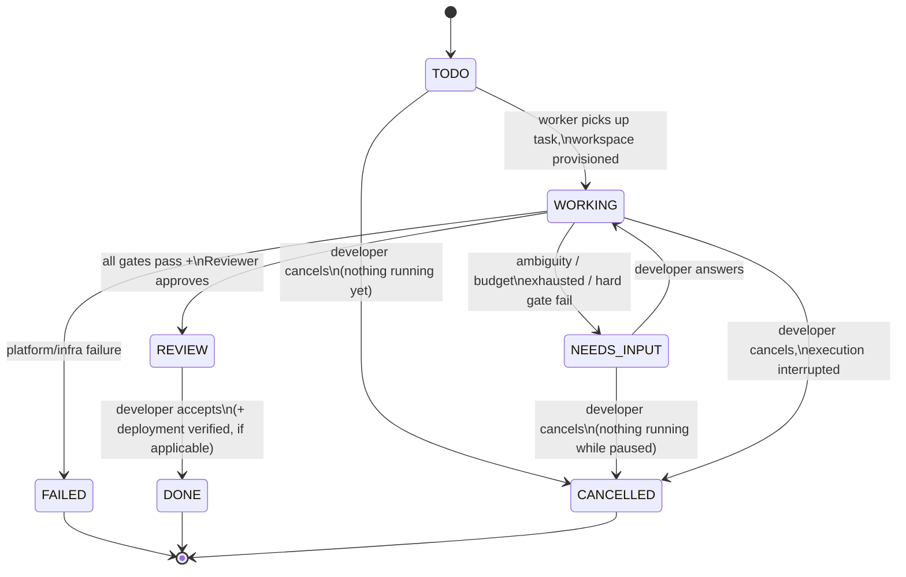
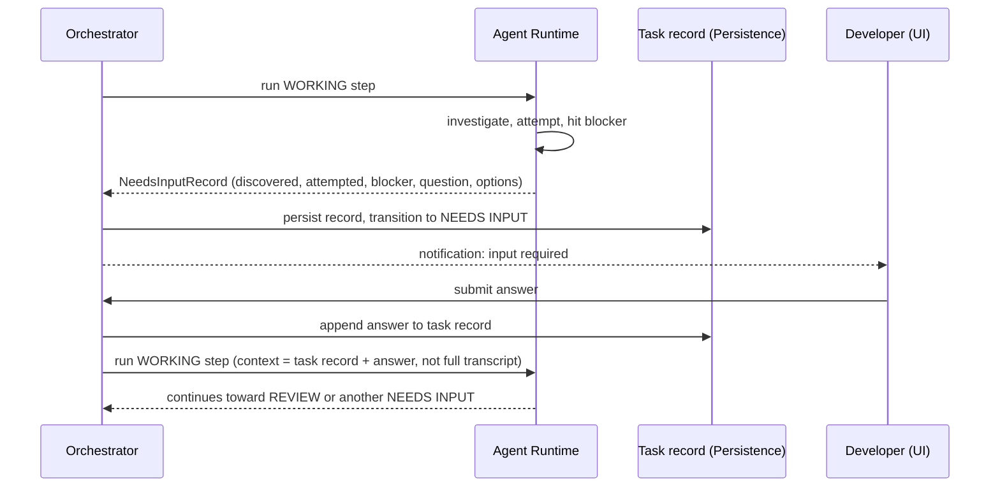
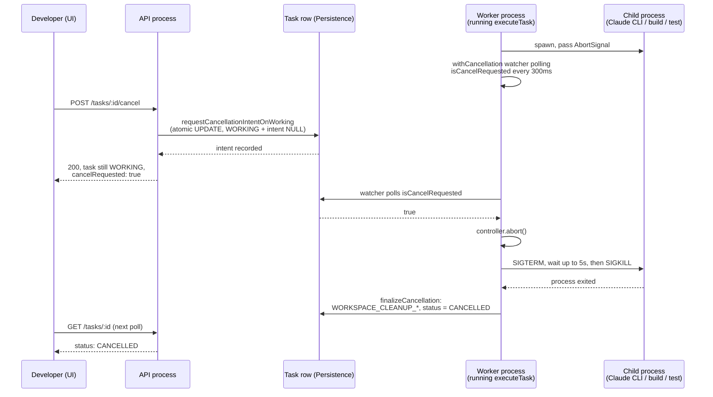

# Task Lifecycle

## States

```
BACKLOG -> TODO -> WORKING -> REVIEW -> DONE
                       \          \-> NEEDS INPUT -> WORKING
                        \
   ------------------------------> CANCELLED  (also reachable from BACKLOG, TODO, and NEEDS INPUT)
```

- **BACKLOG** — every task is created here (see "Task creation" below); not yet eligible for a worker to pick up. Its title/goal/branch selection can still be edited, and explicit dependencies on other tasks in the same project can be added/removed, only while `BACKLOG` — see "BACKLOG editing" and "Task dependencies" below. Leaves `BACKLOG` only via an explicit developer "Start Task" action, gated on its dependencies (see "Task dependencies").
- **TODO** — released from BACKLOG, not yet picked up by a worker.
- **WORKING** — the Orchestrator is actively driving Implementer/gate/Reviewer steps (see [AGENT_ARCHITECTURE.md](./AGENT_ARCHITECTURE.md)).
- **NEEDS INPUT** — the system stopped because it cannot safely proceed without a human decision. Not a failure state; a controlled pause.
- **REVIEW** — implementation passed all gates and the Reviewer; a report is ready; developer reviews (and, if the project has deployment configured, may approve deployment).
- **DONE** — developer has accepted the result (or, when configured, deployment succeeded and was verified).
- **CANCELLED** — the developer stopped the task before it reached a result. Terminal, and not a failure — see "Cancellation" below.

A task also carries a terminal **FAILED** state, reserved for cases outside the model's control (e.g. repository unreachable, workspace provisioning failure) — distinct from `NEEDS INPUT`, which is reserved for cases requiring a human *decision*, not a human *fix of the platform*, and distinct from `CANCELLED`, which is a deliberate developer decision, not an error of any kind.

## What drives each transition

| Transition | Trigger |
|---|---|
| `BACKLOG -> TODO` | Developer explicitly clicks "Start Task" (`Orchestrator.startTask`, HTTP `POST /tasks/:id/start`) — never automatic. Rejected (`409`, incomplete dependencies named) unless every dependency this task lists is itself `DONE`. See "Task dependencies" below. |
| `TODO -> WORKING` | Worker picks up the task; workspace is provisioned. |
| `WORKING -> NEEDS INPUT` | Implementer reports genuine ambiguity, self-fix loop exhausts its budget, or a gate hard-fails without a safe automatic remedy. |
| `NEEDS INPUT -> WORKING` | Developer submits an answer; Orchestrator re-enqueues with the answer folded into the next invocation's context. |
| `WORKING -> REVIEW` | All configured gates pass and the Reviewer invocation approves. |
| `REVIEW -> DONE` | Developer accepts the result (MVP: manual "accept"; deployment-integrated projects may also require successful, verified deployment). |
| any -> `FAILED` | Platform-level failure unrelated to the model's judgment (infra/provisioning/provider outage). Distinct from `NEEDS INPUT`. |
| `BACKLOG` / `TODO` / `WORKING` / `NEEDS INPUT` -> `CANCELLED` | Developer requests cancellation. See "Cancellation" below for exactly what "requests" means for each. |

The Orchestrator is the only component allowed to write task-state transitions; the Agent Runtime and adapters only report step results (see [ARCHITECTURE.md](./ARCHITECTURE.md#5-task-orchestrator)). Cancellation is no exception: the API/application layer never sets `status` — it calls `Orchestrator.requestCancellation()`, an explicit domain command (see [API.md](./API.md)).

## Cancellation

**Cancellability**: `BACKLOG`, `TODO`, `WORKING`, and `NEEDS_INPUT` can all be cancelled. `REVIEW`, `DONE`, and `FAILED` cannot — attempting to returns `409 INVALID_STATE_TRANSITION` (see [API.md](./API.md)). `CANCELLED` itself is terminal: no transition resumes it, and there is no compelling product reason in this MVP to add one (an accidental cancellation just means creating a new task). Cancelling from `BACKLOG` finalizes immediately, the same as `TODO`/`NEEDS_INPUT` (see below) — nothing is ever executing for a `BACKLOG` task, and it typically has no workspace yet to clean up.

**Why REVIEW/DONE aren't cancellable**: by the time a task reaches REVIEW, execution has already finished — there is nothing running left to *stop*. "I don't want this result" from REVIEW is a different capability (discarding a finished, validated result) than cancellation (interrupting one in progress), and isn't built in this step.

**The core principle governing every race below**: cancellation only preempts work that has **not yet started**; it never retroactively discards a step that has **already completed**. Concretely: the Orchestrator checks for a pending cancellation only at loop boundaries — before starting the next Implementer attempt, before starting validation, before starting the next Reviewer attempt — never in the middle of deciding what a step's own result means. This one rule is what makes every race in the table below deterministic without needing case-by-case logic.

### What "requesting" cancellation actually does

Cancellation is deliberately two different mechanisms depending on whether anything is currently running:

- **BACKLOG / TODO / NEEDS_INPUT** — nothing is executing anywhere (BACKLOG and TODO haven't started; NEEDS_INPUT is paused awaiting an answer). `requestCancellation()` finalizes immediately: an atomic, guarded `UPDATE` transitions the task straight to `CANCELLED` and workspace cleanup (if a workspace exists — a BACKLOG/TODO task typically has none yet; NEEDS_INPUT tasks resume into an already-provisioned one) runs right there, synchronously with the request.
- **WORKING** — something *might* be executing, possibly in a different OS process (the API and the worker are separate processes — see [TECHNICAL_DECISIONS.md](./TECHNICAL_DECISIONS.md) TD-16 — so the process handling the cancel request cannot simply reach into another process's memory and kill a child process directly). `requestCancellation()` only persists **intent** — `cancel_requested_at`/`cancel_requested_by` on the task row — and returns immediately with the task still `WORKING`. Whichever process is actually driving that task's execution (via `Orchestrator.executeTask()`) is the only thing that can safely finalize it: a lightweight in-process watcher (`withCancellation`, polling every `cancellationPollIntervalMs`, default 300ms) notices the persisted intent and aborts the live `AbortSignal` that every Implementer/Reviewer/validation call was given — see "Process termination" below. If nothing happens to be executing that task at the moment intent is recorded (e.g. between worker poll cycles), the next `executeTask()` call finalizes it immediately via a fast-path check, without starting a fresh Implementer pass first.

This is why a cancelled `WORKING` task briefly shows `cancelRequested: true` while still `WORKING` (the UI shows "Cancelling…") before flipping to `CANCELLED`.

### Race-condition resolution

| Case | Resolution |
|---|---|
| **A** — Cancel clicked while WORKING | Intent recorded; the in-flight execution's watcher aborts it (see above), typically within one `cancellationPollIntervalMs`. |
| **B** — Agent finishes at the same moment Cancel is clicked | If the Implementer's `run()` call had already returned before the watcher's next poll, the loop proceeds to its next boundary check — where it now *does* see the pending intent and stops there, before starting validation. The completed step's result is not discarded; a validation pass that hadn't started yet simply never starts. |
| **C** — Validation finishes while Cancel is requested | Same principle: a validation run in flight finishes normally (its result is used to decide retry-vs-continue as usual); the very next boundary check (before the next Implementer attempt, or before `prepareChanges`) is where cancellation takes effect. |
| **D** — Reviewer finishes (approves) while Cancel is requested | Deliberately **no** boundary check between "Reviewer approved" and transitioning to `REVIEW` (see `runWorkingEpisode`'s comment at that exact point) — a change that has already passed independent review is a real, validated result; cancellation does not retroactively throw it away. The task reaches `REVIEW`, not `CANCELLED`. If the developer still wants to stop there, `REVIEW` isn't cancellable (see above) — the pending `cancel_requested_at` on the (now-REVIEW) task row is simply never consulted again. |
| **E** — Worker claims a TODO task while Cancel arrives | Both `claimTodo` and `finalizeCancellationOnTodo` are guarded, atomic, single-statement `UPDATE`s against the same `status = 'TODO'` precondition — only one can win. If the claim wins, the cancel request retries against the now-`WORKING` task (falls into Case A). If the cancel wins, the claim's `UPDATE` affects zero rows and the worker's `executeTask()` call returns the already-`CANCELLED` task untouched. |
| **F** — Task is already DONE/REVIEW/FAILED when Cancel arrives | Rejected with `409 INVALID_STATE_TRANSITION` — never silently accepted, per the "REVIEW/DONE aren't cancellable" rule above. |
| **G** — Task is NEEDS_INPUT when Cancel is requested | Cancelled immediately (see "TODO / NEEDS_INPUT" above) — there is no live execution to interrupt, and the developer doesn't have to answer a question for a task they no longer want. The (now historical) open `HumanInputRequest` is left as-is, preserved for audit — never deleted. |
| Repeated cancellation of the same task | Idempotent at every stage: already-`CANCELLED` returns as-is; an already-pending intent on a `WORKING` task is not re-recorded (`requestCancellationIntentOnWorking` only fires the `CANCEL_REQUESTED` event the first time). |

### Process termination

The `AbortSignal` from `withCancellation` is threaded through every long-running child process this execution can spawn — the Implementer/Reviewer invocation (`CodingEngine.run()`), and every validation check (build/test/lint/typecheck). On abort, each owns exactly one graceful-then-forced termination policy (`terminateGracefully`, `src/process/terminate-gracefully.ts`, shared by `ClaudeCodeAdapter` and the validation runner): **SIGTERM**, a bounded grace period (5s default), then **SIGKILL** if the process is still alive. Only the specific child process this platform itself spawned for this one invocation is ever signaled — never a PID or process group looked up by name (see [SECURITY_ARCHITECTURE.md](./SECURITY_ARCHITECTURE.md)).

### Workspace cleanup

Once a task is finalized as `CANCELLED`, its isolated task workspace (the disposable clone under `workspaces/<taskId>`, never the developer's actual connected repository) is torn down the same way normal task cleanup would (`WorkspaceProvider.destroy`) — recorded as `WORKSPACE_CLEANUP_STARTED`/`WORKSPACE_CLEANUP_COMPLETED` events. This never removes the audit trail: every `TaskEvent` and `AgentRun` recorded before cancellation stays exactly as it was — that's the evidence of what the task was doing when it was stopped.

### Recovery

A cancellation intent is just another persisted field on the task row, so it survives a crash the same way the rest of task state does (see [TECHNICAL_DECISIONS.md](./TECHNICAL_DECISIONS.md) TD-12): if the worker process dies with a cancellation pending, `recoverOrphanedTasks()` finds the orphaned `WORKING` task exactly as it would for any other crash, and the next `executeTask()` call's fast-path check finalizes the pending cancellation immediately — the task converges to `CANCELLED`, not stuck `WORKING` forever, and not silently resumed as if nothing had been requested. See "Crash recovery" below for the general mechanism this relies on.

## Crash recovery

Every `WORKING` task's state — `branchName`, `pullRequest`, `selfFixAttempts`, `pendingHumanReviewFeedback`, every `TaskEvent`, every `AgentRun` — is a normal database row, written before (or as part of) the step it describes, never held only in a process's memory. This is what makes recovery possible at all: nothing needs to be reconstructed from a transcript, because nothing important only ever existed in memory.

**Detecting a crash.** A worker/API process holds a task via a leased claim (`TaskRepository.claimTodo`/`claimWorking`, `lock_owner` + `lock_expires_at` — see TECHNICAL_DECISIONS.md TD-12). While a live execution is genuinely still running, `Orchestrator.withCancellation` renews that lease periodically (`leaseHeartbeatIntervalMs`, well below `taskLeaseMs`) — an episode spanning multiple self-fix/review cycles can easily outlast `taskLeaseMs` on its own, and without renewal that would look identical to a crash. Once the lease is no longer renewed (the process that held it is gone), it simply expires; `Worker.tick()` calls `recoverOrphanedTasks()` every poll, which finds `WORKING` tasks past their lease and marks any `AgentRun` still `"running"` as `"interrupted"` — evidence, not a status the task itself ever shows. The task row itself is untouched: still `WORKING`, its lease now expired, so any process's next `claimWorking` call can win it.

**Resuming.** Recovery is coarse-grained, not a fine-grained "resume exactly where it stopped": a re-claimed `WORKING` task re-enters the same top-level function it would have for its trigger — `runWorkingEpisode` (claimed from `TODO`, or via the AI reviewer's own internal fix loop) or `runHumanFeedbackFixCycle` (claimed via a human's GitHub review — see "Human review feedback loop" and below). Whatever already-completed work exists (a provisioned workspace, a passing validation run, a pushed commit, an opened PR) is *reused*, never redone from scratch — each of those steps checks its own persisted evidence first:

- **Workspace/branch**: `provisionWorkspace` checks `WorkspaceRepository.findByTaskId` before calling the provider at all — a `"ready"` workspace is returned as-is, with no `WORKSPACE_CREATED`/`BRANCH_CREATED` event re-emitted (these are one-time creation events; re-entering the function isn't a second creation). A `WorkspaceProvider.provision()` call always clones to the same deterministic `<workspacesRoot>/<taskId>` path regardless of how many times it's invoked.
- **PR**: `ensurePullRequest`'s existing short-circuit on `taskRecord.pullRequest` (see "Evidence-based completion") applies exactly the same way on a recovery re-entry as on any other retry.
- **Commit/push**: `commitAllLocal` is itself a no-op (returns the current `HEAD`, no error) when there's nothing new to commit — see [GITHUB_INTEGRATION.md](./GITHUB_INTEGRATION.md) — so a redundant re-run of `prepareChanges` after a crash is harmless, not an error.
- **AgentRun attemptNumber**: derived from `agentRunRepo.listForTask(taskId).filter(role).length + 1` (`Orchestrator.nextAttemptNumber`) — a count of real persisted rows, including interrupted ones — rather than a separately-tracked counter that only advances at certain checkpoints. This is what guarantees a recovered attempt never collides with the interrupted one it's replacing: the interrupted row's own existence is what pushes the next number up, regardless of exactly when the crash happened.
- **Human review feedback fix cycle**: this is the one recovery path needing an explicit marker, because it's a genuinely different function than the original pipeline and `executeTask` has to know *which* one to resume. `TaskRecord.pendingHumanReviewFeedback` is set (persisted, before any work starts) the moment the cycle is claimed, and cleared (also persisted) the moment it ends (success, `NEEDS_INPUT`, or failure) — `executeTask`'s dispatch checks it on every `WORKING` claim: if set, resume `runHumanFeedbackFixCycle` (which itself reads the feedback back out of the same field, not a parameter); if not, resume the original `runWorkingEpisode`. The one-time `HUMAN_REVIEW_CHANGES_REQUESTED` trigger event is emitted by the *caller* (`checkHumanReviewFeedback`), not by `runHumanFeedbackFixCycle` itself, specifically so a recovery re-entry into the fix cycle never re-emits it.

**What "coarse-grained" costs.** A crash during, say, the AI Reviewer's own invocation causes the *whole* episode to restart from the top on recovery — the self-fix loop's Implementer runs again too, even though it had already succeeded. This produces extra `AgentRun` rows and (harmless, idempotent) repeated `COMMIT_CREATED`/`BRANCH_PUSHED` events. This is a deliberate simplification, not an oversight: the platform's own stated invariant is "one workspace, one branch, one PR — multiple AgentRuns/commits are allowed" (see [ARCHITECTURE.md](./ARCHITECTURE.md)), and redoing bounded, cheap, idempotent work is a simpler and more robust recovery model than threading fine-grained "resume point" state through every step of `runWorkingEpisode`. The one case worth the extra precision is the human review feedback fix cycle, precisely because getting it wrong there doesn't just waste an attempt — it silently runs the *original* pipeline logic (no reviewer feedback in context, then wrongly re-invokes the AI Reviewer) instead of the fix the human actually asked for.

**Cancellation still works after a restart.** A recovered `WORKING` task goes through the exact same `Orchestrator.executeTask` → `withCancellation` path as any other execution, so `requestCancellation` and the fast-path/mid-episode checks described above apply identically, regardless of which process (or how many crashes) got the task to this point.

**A genuine in-process exception** (a bug, not a crash) is a different, already-narrower case: it's caught by `executeTask`'s own `try/catch`, which fails the task cleanly (`FAILED`, `TASK_FAILED`) and releases the lock in a `finally` — never left `WORKING` with no live process behind it.

## Worker concurrency and lease loss

Crash recovery (above) handles the case where the process holding a lease is actually gone. Concurrency V1 (see `migrations/009_lock_generation.sql`) closes a narrower, more dangerous gap: a process that is *not* gone, but has merely lost its lease — its lease expired without a heartbeat renewal (the same conditions `recoverOrphanedTasks` already treats as "orphaned"), a second worker legitimately recovered and is actively driving the task, and the *first* worker's own in-flight `executeTask()` call eventually resumes (its `await` on a slow git/HTTP/child-process call finally returns) and tries to keep going as if nothing happened.

**Lease generations.** `tasks.lock_generation` is an ownership epoch, not a version counter for every field. It advances only when the lease changes hands — a winning `claimTodo` / `claimWorking` / `claimReviewForHumanFeedback` call — never on a same-owner heartbeat renewal (`TaskRepository.renewWorkingLease`, used exclusively by `Orchestrator.withCancellation`'s heartbeat interval). Every execution captures the generation it was granted at claim time and threads it through everything it does (`runWorkingEpisode`, `runHumanFeedbackFixCycle`, `runAgent`, `provisionWorkspace`, `prepareChanges`, `ensurePullRequest`) as its ownership identity for that run.

**Fenced writes.** Every task write a live execution makes goes through `TaskRepository.saveOwned(task, generation, now)` (`UPDATE ... WHERE lock_generation = ?`), never the unconditional `save()` user-initiated commands (`submitHumanAnswer`, `acceptReview`, cancellation finalization, ...) still use. A fenced write that no longer matches the row's current generation performs no write and returns `false`; `Orchestrator.saveOwned` turns that into a `LeaseLostError`, which propagates out to `executeTask`'s existing catch block — the same one crash recovery's heartbeat failure already raises. `AgentRunRepository.complete()` is fenced the same way, via an `EXISTS` subquery comparing the run's `owner_generation` (captured at insert time) against the task's *current* `lock_generation` — a stale execution's own AgentRun can never be marked completed once ownership has moved on.

**Before high-consequence side effects** (validation commands, git commit, git push, PR creation) `Orchestrator.assertStillOwned` re-reads the task's current generation immediately before the call — narrowing, not eliminating, the window between "we're still the owner" and an external git/GitHub call that can't itself be part of the same DB transaction.

**LeaseLostError is not a failure.** Exactly like crash recovery's own heartbeat-detected lease loss, a fenced write losing the race is `EXECUTION_LEASE_LOST` in the TaskEvent log — visibly distinct from `TASK_FAILED` (a genuine platform failure) and `TASK_CANCELLED` (a human-requested stop). Task status and workspace are left completely untouched: whoever now holds the lease may already be legitimately using both.

**Workspace fencing.** `workspaces.active_generation` prevents two different generations from both believing they're the current writer of the same on-disk checkout. `Orchestrator.provisionWorkspace` claims a (possibly reused) `"ready"` workspace for its own generation via `WorkspaceRepository.claimForGeneration` (strictly-increasing only) before ever handing it back to be written into; a stale generation loses that claim and aborts via `LeaseLostError` before touching a single file.

**Bounded worker concurrency.** `WORKER_MAX_CONCURRENT_TASKS` (default 2 — see `.env.example`, `src/worker/worker.ts`) caps how many TODO/WORKING executions one worker process runs at once. `Worker.tick()` computes remaining capacity and only dispatches that many new candidates; the rest simply stay `TODO` and are reconsidered on the next poll — no queue, no new `BLOCKED` status. The separate REVIEW/human-review-feedback poll is not subject to this cap (it's cheap — a no-op unless a task's PR actually has new feedback).

## Task creation: description → executable task

The developer supplies a short plain-language description. The Orchestrator does not require it to be a technical prompt; the Implementer's own repo investigation (seeded by the project's context files, see [CONTEXT_ARCHITECTURE.md](./CONTEXT_ARCHITECTURE.md)) is what turns "login fails when OTP is entered after session timeout" into a concrete plan. The platform does not run a separate "requirements translation" agent step — that would be exactly the redundant Planner role rejected in [AGENT_ARCHITECTURE.md](./AGENT_ARCHITECTURE.md). The description is stored verbatim as the task's `goal`, and the Implementer's own plan (produced during its first invocation) is persisted as part of the task record so it isn't re-derived on every resume.

Every task is created into `BACKLOG`, never directly into `TODO` — a worker never picks it up until a developer explicitly releases it (see "Task dependencies" below). Creation may optionally list other tasks in the same project this one depends on (`dependencyIds`); a brand-new task can never itself be part of a cycle (nothing can depend on a task that didn't exist a moment ago), so only existence and same-project membership are checked at creation time — full cycle detection applies to dependencies added later via the dedicated endpoint below.

## BACKLOG editing

While (and only while) a task is `BACKLOG`, its title, goal, and branch selection (`branchMode`/`workingBranch`/`baseBranch`) can be edited (`TaskService.editBacklogTask`) — reusing the exact same validation `create()` itself uses, so an edited task can never end up in a state creation couldn't have produced directly. Server-enforced, not just hidden in the UI: an edit attempt on a task that has already left `BACKLOG` (including one that raced a concurrent "Start Task") is rejected (`409`, `TaskNotEditableError`), never silently applied or silently dropped.

## Task dependencies

A task may explicitly declare that it depends on other tasks in the **same project** (`POST`/`DELETE /tasks/:taskId/dependencies`, `TaskService.addDependency`/`removeDependency`) — editable only while the dependent task is `BACKLOG`, same as the rest of BACKLOG editing above. Key rules:

- **Explicit only, never inferred.** The platform never guesses a dependency from task descriptions or file overlap — every edge is a developer's own explicit choice.
- **AND semantics, DONE-only satisfaction.** A task's dependencies must ALL be `DONE` (not merely non-`FAILED`, not `REVIEW`) before it can be released from `BACKLOG` — see the `BACKLOG -> TODO` transition above.
- **Same-project only.** A dependency across two different projects is rejected outright (`400 CROSS_PROJECT_DEPENDENCY`) — same-project membership is validated by `TaskService`, the only layer that can resolve both tasks' project ownership.
- **No self-dependency, no duplicate edges.** Rejected at `400`/`409` respectively; duplicate rejection is a real database constraint (the edge table's own primary key), not just an application-level check.
- **Cycles rejected, at any depth.** Adding an edge that would create a circular dependency chain — direct or indirect, however many hops — is rejected (`409 CIRCULAR_DEPENDENCY`). The check is a real graph reachability traversal over the project's full dependency edge set, not a shallow direct-pair check, and is enforced atomically against concurrent writers at the database layer (a single SQL statement combining the BACKLOG guard and a recursive cycle check), not just in application code.
- **No `BLOCKED` task status.** An incomplete-dependency task is not a distinct status — it simply stays `BACKLOG` until either its dependencies complete or a developer removes the edge. "Blockedness" is derived and displayed (e.g. "Blocked by: <task title>") from the live dependency list, never persisted as its own state.

## Branch modes

Every task resolves to exactly one `branchMode` at creation time, immutable thereafter:

- **`"new"` (default, and the only behavior that existed before this field did).** An isolated branch is created for the task, from the project's default branch unless the creator supplied a `baseBranch` override. The branch name is auto-derived (`task/<id-prefix>`) unless the creator supplied a custom `workingBranch`, which is validated against a conservative safe charset (see `src/api/schemas.ts` `isSafeBranchName`) and rejected outright if it's identical to its own base branch. This is the safe default: two "new" tasks against the same project always get independent branches, so nothing about branch modes changes the platform's existing concurrency guarantees for the common case.
- **`"existing"`.** The task checks out a user-selected branch directly — `git clone --branch <branch> --single-branch`, with no follow-up `git checkout -b` — and every commit/push in `runWorkingEpisode`/`prepareChanges` lands directly on it. The platform has no mechanism to serialize or lock concurrent pushes to one branch, so rather than inventing one, a second concurrent (non-terminal) task in the same project targeting the exact same branch is rejected at creation time (`BranchInUseError`, HTTP 409) — see `TaskService.create`. The selected branch is also confirmed to actually exist before the task is created: authoritatively via a real GitHub API check for a `github` project, best-effort via `git ls-remote --heads` for `local-git` (which returns `[]`, not an error, when the remote can't be enumerated — treated as "couldn't verify," not "no branches exist").

In both modes the workspace's own filesystem isolation (`<WORKSPACES_ROOT>/<taskId>`, one directory per task) is unaffected — isolation is per-task-directory, not per-branch, so branch mode never weakens it. The Pull Request's base (merge target) is always the project's default branch in `"existing"` mode, and whatever the task branched from (its base branch, which may itself be a non-default override) in `"new"` mode.

A `Task` row from before this field existed has no `branch_mode`/`working_branch`/`base_branch` columns populated meaningfully; it's always read back as `branchMode: "new"` with no overrides — i.e. exactly its original behavior, never an error.

## The NEEDS INPUT contract

A `NEEDS INPUT` transition must always carry a structured record, not free text alone:

```
NeedsInputRecord
  discovered: string        # what was found in the codebase/tests
  attempted: string[]       # what was tried
  blocker: string           # precisely why it can't proceed
  question: string          # the specific decision needed
  options: Option[]         # recommended choices, with tradeoffs, where applicable
```

**Rule: the system must never ask for information it can determine itself.** In practice this is enforced by requiring `discovered` and `attempted` to be non-trivial before the Orchestrator accepts a `NEEDS INPUT` report — a report that skips investigation is treated as a defect in the Implementer step, not a valid pause.

Answering does not require the developer to restate context: the Orchestrator builds the next invocation's context bundle from the persisted task record + the new answer, per [CONTEXT_ARCHITECTURE.md](./CONTEXT_ARCHITECTURE.md) — it never replays the full prior transcript.

## Evidence-based completion (the REVIEW gate)

A task cannot reach `REVIEW` on the Implementer's self-report. The gate sequence (project-configurable, see [ARCHITECTURE.md](./ARCHITECTURE.md#12-review--quality-gates)) is:

```
Implementation -> Tests -> Static analysis -> Security checks (if configured)
  -> Independent Reviewer invocation -> Regression validation -> REVIEW
```

Any hard failure routes back to `WORKING` (if the self-fix budget allows another attempt) or to `NEEDS INPUT` (if it doesn't, or if the failure looks like it needs a judgment call rather than another attempt).

**Since Step 7**, reaching `REVIEW` also requires the platform to have committed, pushed, and opened (or idempotently found) a real Pull Request — see [GITHUB_INTEGRATION.md](./GITHUB_INTEGRATION.md) "Commit / push as a real gate" and "Pull Request." A commit, push, or PR-creation failure routes to `FAILED` instead, with whatever evidence was produced before the failure (e.g. a real commit sha even if the push itself failed) preserved on the task record — never a silent skip that lets the task reach `REVIEW` without a real PR behind it. No new `TaskStatus` value was added for this — it's the existing `infra_failure` → `FAILED` transition, same as any other platform-level failure.

### Review/fix cycle

"Independent Reviewer invocation" above is not a single pass — a rejection ("changes requested") triggers a bounded self-correction loop, all still inside the single `WORKING` episode (no new `TaskStatus`, matching the state machine's existing "internal execution steps are tracked via AgentRun + TaskEvent, not additional Task states" principle):

```
Implementer -> Validation -> Commit -> Push
  -> Reviewer
       |-- APPROVED -> Pull Request (opened/reused) -> REVIEW
       `-- CHANGES_REQUESTED -> Implementer (fix, same workspace/branch) -> Validation -> Commit -> Push -> Reviewer (again)
```

- **Same workspace, same branch, one PR, always.** The workspace and branch are provisioned exactly once per task, *before* this loop starts — a rejection re-runs only the Implementer, validation, and commit/push, never re-provisions anything. The PR is opened exactly once, only after an `APPROVED` verdict (idempotency guard: `Orchestrator.ensurePullRequest`'s own short-circuit on an already-recorded `taskRecord.pullRequest`, plus the `SourceControlProvider`'s own search-before-create — see [GITHUB_INTEGRATION.md](./GITHUB_INTEGRATION.md) "PR idempotency").
- **Reviewer findings reach the fix pass as structured feedback**, not a replayed transcript: the Implementer's `ContextBundle` gets a `reviewerFeedback: ReviewResult` (verdict, findings, the Reviewer's own summary) instead of the self-fix loop's `lastFailure` — a review-triggered fix always follows a *passing* validation run, so there's no validation failure to report alongside it. `buildImplementerPrompt` renders this as an explicit "Reviewer verdict / Reviewer findings / Instructions" block — see `src/coding-engine/prompt-builder.ts`.
- **Verdict detection**: real models overwhelmingly answer in prose, not a structured findings array — `buildReviewerPrompt` asks for an explicit closing `VERDICT: APPROVED` / `VERDICT: CHANGES_REQUESTED` line (with `FINDING:` lines above it when rejecting), and `deriveReviewResult` (`src/review/reviewer.ts`) parses it. An explicit verdict line always wins over the older completed-status heuristic, which remains the fallback for any engine/test double that doesn't emit one. Verified live: a real Gemini reviewer rejected a task citing a specific missing file, the Implementer's fix addressed exactly that finding, and the Reviewer approved on the second pass — same workspace, same branch, one PR.
- **Bounded, not infinite**: `OrchestratorConfig.maxReviewerRejections` (default 2, same config knob used since Step 2 — no new configuration mechanism was introduced) caps the number of fix cycles. Exhausting it **fails the task** (`FAILED`, via the same `infra_failure` transition and `TASK_FAILED` event every other platform-level failure already uses) with a clear reason built from the last Reviewer's real findings — deliberately not `NEEDS_INPUT`: a Reviewer that keeps finding new issues within a bounded retry budget is a concrete, evidence-backed failure to report, not an open-ended question. See TECHNICAL_DECISIONS.md.
- **Observability**: `REVIEW_STARTED` fires before every Reviewer attempt (including retries — distinguishable via its `attemptNumber` and the AgentRun's own `attemptNumber`); a rejection emits `REVIEW_CHANGES_REQUESTED` (carrying the findings) before the fix Implementer starts, so the event log alone shows exactly when and why a cycle repeated.
- **Cancellation**: the same `AbortSignal`/checkpoint model as everywhere else in `WORKING` (see "Cancellation" above) — checked before each Reviewer attempt, before the transition into a fix pass, and inside every step the fix pass itself runs (Implementer invocation, validation, commit, push). A cancellation mid-cycle interrupts cleanly into `CANCELLED`; it never lets the loop continue into another cycle.

### Human review feedback loop

Reaching `REVIEW` is not the end of the story if the connected repository is a real GitHub project: a human reviewer working the actual Pull Request can request changes, and the platform resumes the *same* task from that feedback — without a human ever having to reopen this app. This reuses transitions the state machine already had (`REVIEW --changes_requested--> WORKING`, `WORKING --gates_passed--> REVIEW`) but had no caller for until now:

```
REVIEW -> (poll finds a "changes requested" PR review) -> HUMAN_REVIEW_CHANGES_REQUESTED
  -> Implementer (fix, same workspace/branch) -> Validation -> Commit -> Push -> REVIEW
```

- **Source of feedback**: `SourceControlProvider.listPullRequestFeedback` — a minimal read of the PR's submitted reviews (verdict + body) and conversation comments, not a general GitHub API framework. `local-git` (the dev/test fixture provider) always returns `[]`; only `github` reads anything real. See [GITHUB_INTEGRATION.md](./GITHUB_INTEGRATION.md) "Human review feedback ingestion".
- **What's actionable**: only a submitted review with GitHub's `CHANGES_REQUESTED` state triggers a fix cycle, and only on a PR that's still `open` — a merged or closed PR's feedback is never fetched at all (checked first, via a single-PR state read), so a later worker poll can never re-trigger implementation because of a stray or late review on a PR that's already merged/closed. Approvals and plain comments are recorded (so a repeat poll doesn't re-detect them) but change nothing — the task stays `REVIEW`, and the platform never auto-merges or invents a new terminal state on an approval or a merge. See [GITHUB_INTEGRATION.md](./GITHUB_INTEGRATION.md) "PR state handling".
- **Driven by polling, not a webhook**: the same `Worker` that polls `TODO`/`WORKING` tasks also polls `REVIEW` tasks and calls `Orchestrator.checkHumanReviewFeedback` for each — a no-op unless there's new feedback, and, since the REVIEW polling hardening below, only for a task whose GitHub refresh is actually due. `POST /tasks/:taskId/check-review-feedback` exposes the same operation on demand instead of waiting for the next poll tick, and always calls GitHub directly (an explicit, human-initiated on-demand check bypasses the due-check schedule the same way — it is not throttled by `REVIEW_POLL_INTERVAL_MS`).
- **Same workspace, same branch, one PR — still.** `checkHumanReviewFeedback` never re-provisions anything; it claims the existing task (`TaskRepository.claimReviewForHumanFeedback`, the same atomic-`UPDATE`-with-`WHERE`-guard pattern as `claimTodo`) and runs the Implementer/validation/commit/push directly against the workspace and branch already on the task record. Pushing new commits to the same branch is what "updates" the existing PR — no PR-update API call is made or needed.
- **Feedback reaches the Implementer as an explicit, distinguishable block** — a `ContextBundle.humanReviewFeedback` field (reviewer login + comments), never merged into `priorDecisions` or the AI Reviewer's own `reviewerFeedback`. `buildImplementerPrompt` renders it as a "Human reviewer feedback" block (`Reviewer:` / `Review:` / `Comments:` / `Requested changes:`) so the Implementer can tell apart the original task, the AI Reviewer's feedback, a human's GitHub feedback, and a plain validation failure.
- **Idempotency**: every feedback item's id (`review:<n>` / `comment:<n>`) is recorded in `TaskRecord.processedHumanFeedbackIds` *before* the fix cycle runs, and a repeated poll only ever looks at items not already in that set — a review GitHub still reports on a later poll never triggers a second fix cycle.
- **Observability**: `HUMAN_REVIEW_DETECTED` (new feedback found), `HUMAN_REVIEW_APPROVED` (an approval, informational only), and `HUMAN_REVIEW_CHANGES_REQUESTED` (the actionable trigger) are the only new event types. Everything else in the cycle reuses existing events (`AGENT_STARTED`/`AGENT_COMPLETED`, `VALIDATION_STARTED`/`VALIDATION_COMPLETED`, `COMMIT_CREATED`, `BRANCH_PUSHED`, `TASK_MOVED_TO_REVIEW`).
- **No independent AI review step in this loop** — unlike the AI review/fix cycle above, a human-feedback fix pass goes straight back to `REVIEW` after a passing validation run. The human who requested the change is the one who reviews the result again, on GitHub.
- **Cancellation**: the human-feedback fix cycle runs the task through `WORKING` exactly like any other episode, so it gets the exact same cancellation mechanism for free (`Orchestrator.withCancellation`, the same `AbortSignal`/checkpoint model) — checked before the fix pass starts, inside the Implementer invocation, during validation, and before returning to `REVIEW`. A cancellation mid-cycle lands in `CANCELLED`, never continues into another poll.

### REVIEW polling

**The problem this closes**: before this hardening pass, `Worker.tick()` listed every `REVIEW` task and called `checkHumanReviewFeedback` for it on *every* poll (`POLL_INTERVAL_MS`, default 2s) — which itself makes several real GitHub calls (`getPullRequestStatus`, then `listPullRequestFeedback`). With N worker processes sharing one database, that's up to ~4N GitHub calls every 2 seconds per open-PR `REVIEW` task, with no cross-worker coordination — a real, observed source of GitHub rate-limit and even outright auth errors under normal multi-worker operation.

- **DB-backed schedule, not process-local memory**: `tasks.next_review_check_at` (see `migrations/010_review_poll_scheduling.sql`) records when a `REVIEW` task's PR is next due for a real GitHub refresh. `NULL` (every pre-migration row, and every task the instant it first reaches `REVIEW`) means "never checked, due immediately" — preserves the pre-existing behavior of checking a `REVIEW` task's PR the first time any worker sees it.
- **The gate lives in `Worker.tick()`, not inside `checkHumanReviewFeedback`**: before dispatching a `REVIEW` task to `Orchestrator.checkHumanReviewFeedback`, the worker atomically claims this cycle's check via `TaskRepository.claimReviewCheck(id, now, now + REVIEW_POLL_INTERVAL_MS)` — a single `UPDATE ... WHERE next_review_check_at IS NULL OR next_review_check_at <= ?`, the same atomic-claim idiom `claimTodo`/`claimWorking`/`claimReviewForHumanFeedback` already use. A task that loses the claim (not due yet, or another worker process already claimed it this instant) is filtered out before `checkHumanReviewFeedback` is ever called — so a REVIEW task not due for a refresh makes **zero** GitHub calls, not just a cheap one. `checkHumanReviewFeedback` itself is unchanged: every existing call site that calls it directly (the on-demand `POST /tasks/:taskId/check-review-feedback` endpoint, and every existing automated test) is unaffected by the gate.
- **This is a different claim from `claimReviewForHumanFeedback`**, deliberately: `claimReviewCheck` only ever touches `next_review_check_at` — never `status`/`lock_owner`/`lock_generation` — so it is entirely orthogonal to Concurrency V1's execution-ownership fencing (`migrations/009_lock_generation.sql`). It governs "who gets to make this cycle's read-only GitHub call," never task execution ownership; `claimReviewForHumanFeedback` (REVIEW -> WORKING, for an actionable "changes requested" fix cycle) is untouched.
- **Configurable cadence**: `REVIEW_POLL_INTERVAL_MS` (default 30000ms; see `.env.example`) is a separate, distinct concern from `POLL_INTERVAL_MS` — `POLL_INTERVAL_MS` still governs how often `tick()` itself runs at all (a cheap, indexed `SELECT` listing every REVIEW task on every tick, unchanged); `REVIEW_POLL_INTERVAL_MS` governs how often, once a REVIEW task is looked at, a real GitHub call is actually allowed to happen for it.
- **Rate-limit backoff**: on a `rate_limited` classification from either GitHub read inside `checkHumanReviewFeedback` (`getPullRequestStatus` or `listPullRequestFeedback`), `Orchestrator.maybeExtendReviewBackoff` pushes `next_review_check_at` out further than the worker's own optimistic `now + REVIEW_POLL_INTERVAL_MS` schedule, honoring GitHub's own suggested wait (`Retry-After` / rate-limit reset, via `classifyGitHubError`'s `suggestedDelayMs`) when that is longer than the normal interval — a rate-limited task is never hammered again at the normal cadence, let alone every tick.
- **Auth failures need no extra handling**: an `auth` (401) failure is still surfaced via the existing `SOURCE_CONTROL_FAILED` event, unchanged — and the worker-level claim already deferred the next attempt by a full `REVIEW_POLL_INTERVAL_MS` before the call even ran, so an auth failure is never retried on the very next tick either, without any additional backoff logic needed.
- **GitHub call volume**: was up to ~4 calls every `POLL_INTERVAL_MS` (2s default) *per worker process* for each open-PR REVIEW task; now at most ~4 calls every `REVIEW_POLL_INTERVAL_MS` (30s default) **total**, regardless of how many worker processes are running.

### PR merge sync

**REVIEW vs. DONE, precisely**: `REVIEW` means "AI has completed and validated the implementation, and the human still needs to review and make the final merge decision." `DONE` means "the human-approved change has actually been merged into the repository." Before this mechanism existed, nothing observed a PR's actual merge state — a human merging the PR directly on GitHub (rather than clicking "Accept" in this app) left the task stuck in `REVIEW` forever, even though the work was, in every real sense, finished and accepted. This closes that gap.

```
REVIEW -> (poll finds the PR merged on GitHub) -> DONE           [PULL_REQUEST_MERGED event]
REVIEW -> (poll finds the PR closed, NOT merged) -> stays REVIEW  [no event — nothing changed]
```

- **The platform never merges anything itself, ever.** This mechanism only *observes* a merge a human already performed on GitHub and reflects it into the task's own status — the same "no auto-merge" invariant the PR-creation footer has stated since Step 7 remains true without exception.
- **Where this lives, and why**: folded into the exact same poll `checkHumanReviewFeedback` already runs for every `REVIEW` task with a PR — the same due-check-gated cadence described in "REVIEW polling" above, not a new poller, a faster poller, or a webhook. A webhook would need a public inbound endpoint this MVP doesn't have (same reasoning TD-43 already gave for the human-review-feedback loop itself — see TECHNICAL_DECISIONS.md); reusing the existing polled/atomic-claim architecture (TD-12) was the simplest fit, and the requirement to "reuse the existing human-review polling architecture/cadence" made this the obvious choice over inventing a parallel mechanism.
- **Order of operations inside `checkHumanReviewFeedback`**: the PR's remote status (`SourceControlProvider.getPullRequestStatus`) is checked *first*, before any feedback is fetched. `merged` completes the task immediately (feedback, if any, is irrelevant — the PR is done). `closed`-not-`merged` returns immediately without ever fetching feedback (nothing to act on, no wasted API calls, task stays `REVIEW`). Only an `open` PR falls through to the existing feedback-fetch logic, unchanged.
- **No new `TaskStatus`**: `REVIEW --accepted--> DONE` already existed in the transition table (previously only reachable via a human's explicit `acceptReview()` call in the app). This mechanism drives the *same* transition from a different trigger (an observed GitHub merge instead of an in-app click) — `Orchestrator.finalizeMergedPullRequest` calls the same `task-state-machine` machinery, just via a dedicated atomic repository method (`TaskRepository.finalizeReviewAsDoneOnMerge`) rather than an unconditional `transition()` call, because unlike `acceptReview()` (which trusts an authenticated human action), this path must itself guard against being the *second* caller to observe the same merge.
- **Idempotency and races** (`TaskRepository.finalizeReviewAsDoneOnMerge`): a single atomic `UPDATE ... WHERE status = 'REVIEW'`, the same pattern every other claim/finalize method in this repository already uses (`claimTodo`, `claimReviewForHumanFeedback`, `finalizeCancellationOnTodo`, ...). Two concurrent pollers (same process or different worker processes) that both observe the same merged PR can never both "win": only the first `UPDATE` actually matches, the second is a silent, harmless no-op. Repeated polling of an already-`DONE` task is equally a no-op — the guard is `status = 'REVIEW'`, not "has this PR's merge been seen before," so there is nothing to deduplicate against, by construction. No lease/lock is taken for this transition (unlike claiming `WORKING`): there is no further work happening that a second process could race into mid-execution — this is a single terminal write, not an episode.
- **Crash/restart recovery requires no special handling**: the check is stateless from the platform's own perspective — it always asks GitHub for the PR's *current* real state, never anything the platform itself remembered from before a restart. A merge that happened while no worker process was running is invisible until the next poll of that `REVIEW` task (by any process, old or newly started), at which point it's detected exactly the same way a merge observed by a long-running process would be. No orphan-recovery pass, no special-cased "catch up after restart" code path exists or is needed.
- **GitHub read failures**: reuses the exact same visibility policy `checkHumanReviewFeedback`'s existing feedback-fetch failure handling already established — `classifyGitHubError` decides `retryable_transient`/`rate_limited` (silent, self-heals on the next poll, no permanent audit-trail entry) vs. everything else (auth, permission, ...), which is surfaced via the existing `SOURCE_CONTROL_FAILED` event (`payload.step: "check_pull_request_status"`) without ever failing the task. Critically, a failed/uncertain status read never risks a false `DONE` — the task simply stays `REVIEW` and the next poll tries again.
- **Cancellation**: `REVIEW` has no outgoing `cancel` transition in the state machine (see task-state-machine.ts's own doc comment — nothing is running to interrupt, and discarding an already-reviewed result is a different, out-of-scope capability), so a cancellation request against a `REVIEW` task is rejected outright by `requestCancellation` regardless of this mechanism; the merge-sync check is unaffected by, and cannot be affected by, a cancellation race.
- **Observability**: one new event, `PULL_REQUEST_MERGED` (carries the PR's `provider`/`number`/`url`, from the task's own already-recorded `TaskRecord.pullRequest` — never a client-supplied value). Deliberately does **not** also append the generic `TASK_COMPLETED` event a manual `acceptReview()` uses — `PULL_REQUEST_MERGED` is itself an unambiguous, final completion signal, and staying the single most-recent event is what lets the API layer render the specific "Completed — PR #N merged" activity string (see `api/dto.ts`'s `deriveCurrentActivity`) instead of the generic "Done" a manual accept produces. The frontend renders this the same way it renders every other event, via the existing `EVENT_LABELS` convention — no parallel event/activity system.
- **Security**: the PR looked up is always `task.taskRecord.pullRequest` — the platform's own server-side record of the PR it opened for this task — never a client-supplied PR number or status. There is no API surface that lets a client claim a PR is merged; the only source of truth is GitHub's own API response.

**Update (Phase 4D.4)**: at the time the paragraph above was written, "a human's explicit `acceptReview()` call in the app" was aspirational — `acceptReview()` existed in `Orchestrator` but had no caller anywhere (no `TaskService` wrapper, no API route, no UI button). Phase 4D.4 is what actually wired it up, via Chat's human-confirmed completion flow (`TaskService.completeTaskByHuman` → `Orchestrator.acceptReview`, now called only after an explicit user confirmation) — see `docs/CHAT.md` "Human-confirmed Review → Done completion." The automatic PR-merge path described in this whole section remains completely unchanged by that addition.

## Task report (shown at REVIEW)

```
Task: <title>
What was wrong: <summary>
What changed: <summary>
Files changed: <n>
Tests: <passed>/<total>, <failed> failed
Validation: build <pass/fail>, static checks <pass/fail>, regression <pass/fail>
Confidence: <High|Medium|Low>   # from the Reviewer invocation, not the Implementer
Status: Ready for review | Ready for deployment approval
Pull Request: <url/#number, branch -> base branch>   # since Step 7 — see GITHUB_INTEGRATION.md; absent for local-git projects or before REVIEW
```

Full diffs, logs, and gate output remain available via "View Details," never inline on the board (see [PRODUCT_REQUIREMENTS.md](./PRODUCT_REQUIREMENTS.md)).

## Execution history and observability

The Task Detail UI/API exposes a fuller execution history than the concise report above — every `AgentRun`, a duration breakdown, and richer failure/recovery context. This is deliberately a second *view* over the exact same `AgentRun`/`TaskEvent` rows everything else in this document already describes, not a second parallel event/history system: `src/reporting/execution-history.ts` is a set of pure functions that read existing persisted evidence and derive a presentation-friendly shape, wired into the existing `GET /tasks/:taskId/report` response (see [API.md](./API.md)) rather than a new endpoint.

- **Agent run history** (`TaskReport.agentRuns`): every `AgentRun`, in order, each with a derived `trigger` — `"initial"` (the first Implementer pass), `"self_fix_retry"` (a validation-failure retry — `ContextBundle.lastFailure` was set), `"ai_review_fix"` (the AI Reviewer rejected — `reviewerFeedback` was set), `"human_review_fix"` (a human's GitHub review requested changes — `humanReviewFeedback` was set), or `"review"` (any Reviewer-role run). All four of these signals already existed on the persisted `ContextBundle`; this only reads them back out. A Reviewer run's `verdict` is derived with the exact same `deriveReviewResult()` the Orchestrator itself uses to decide `APPROVED`/`CHANGES_REQUESTED` — never a second, possibly-inconsistent verdict concept.
- **Crash recovery visibility** (`resumedAfterInterruption` per run, `recoveredFromCrash` on the report): a run is "resumed after an interruption" iff the immediately preceding `AgentRun` of the same role has `status: "interrupted"` — the exact status `recoverOrphanedTasks()` already sets on a crash-orphaned run (see "Crash recovery" above). No new event or flag was added to detect this; it's a direct read of that existing status.
- **Durations** (`TaskReport.durations`): `totalMs` (Task.startedAt → completedAt), `implementationMs`/`reviewMs` (summed across every Implementer/Reviewer `AgentRun`'s own startedAt/completedAt), `validationMs` (every paired `VALIDATION_STARTED`/`VALIDATION_COMPLETED` event), `waitingForHumanReviewMs` (the most recent `TASK_MOVED_TO_REVIEW` event to whichever comes first: a human-response event, or the task's own `completedAt`). Every value is `null`, never estimated, when its boundary timestamps aren't both available yet — no new field is persisted; everything is computed from timestamps that already exist.
- **Failure visibility** (`TaskReport.failureContext`, FAILED tasks only): which stage failed (derived from the last relevant event — `AGENT_FAILED`, `SOURCE_CONTROL_FAILED`, `WORKSPACE_FAILED`, or `REVIEW_CHANGES_REQUESTED` — immediately before the `TASK_FAILED` event), which role and attempt number (the last `AgentRun` with status `"failed"` or `"interrupted"`), and whether the task's history includes any crash-recovery resume at all. `AgentRun.error` (a sanitized, already-concise message — never a raw stack trace, see its own persistence contract in orchestrator.ts) is surfaced per-run behind an expandable "Technical error details" element in the UI, not inline by default.
- **Frontend**: `ActivityTimeline` now renders a short detail line per event, extracted from that event's own existing `payload` (see `web/src/lib/eventDetail.ts`) — e.g. "Implementer · attempt 2" for `AGENT_STARTED`, "1/2 checks passed" for `VALIDATION_COMPLETED`. `AgentRunHistory` and `DurationStats` are new, focused components; `ReportPanel` gained a "Recovered from a crash" banner (only when `recoveredFromCrash`) and an expandable "Execution details" section — no redesign of the existing page structure.

## Diagram B — Task execution lifecycle



## Diagram D — Human intervention (NEEDS INPUT) flow



## Diagram E — Cancellation flow (WORKING case)

Note the API process and the worker process are separate (see [TECHNICAL_DECISIONS.md](./TECHNICAL_DECISIONS.md) TD-16) — the request that records intent and the loop that observes it are two different `Orchestrator` instances communicating only through the database, not through shared memory.


