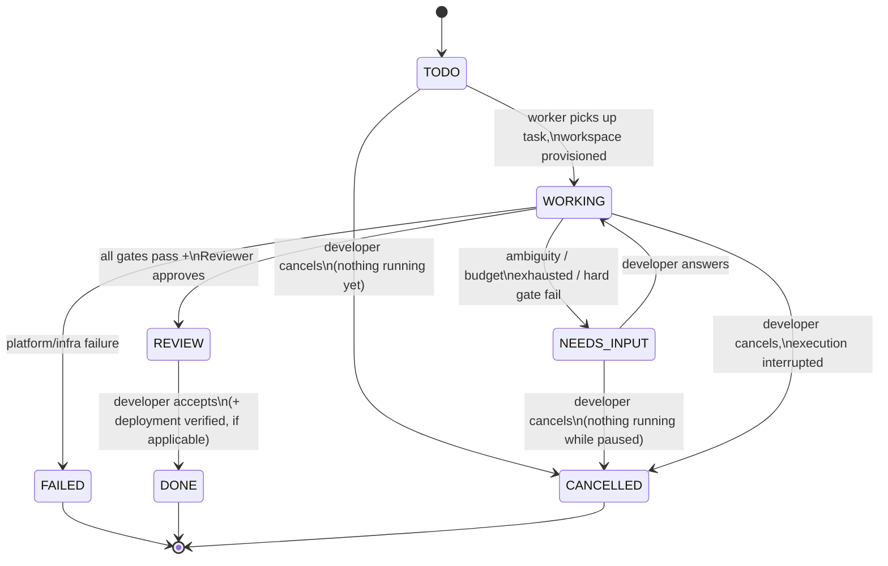
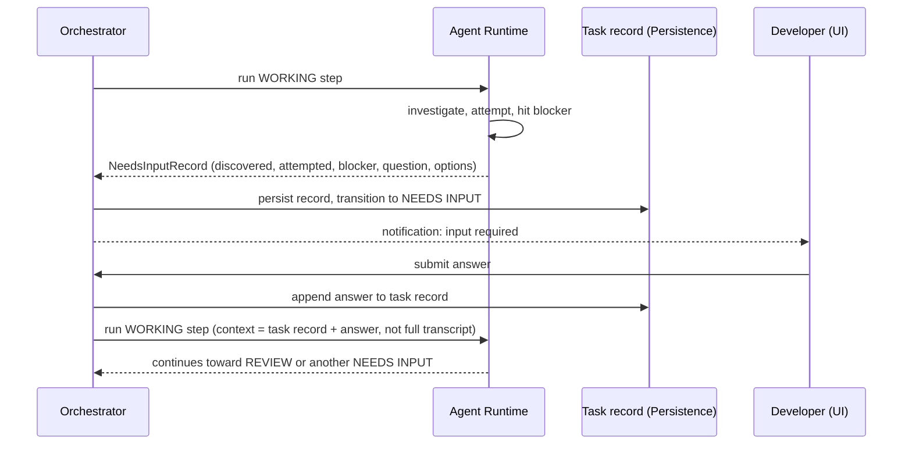
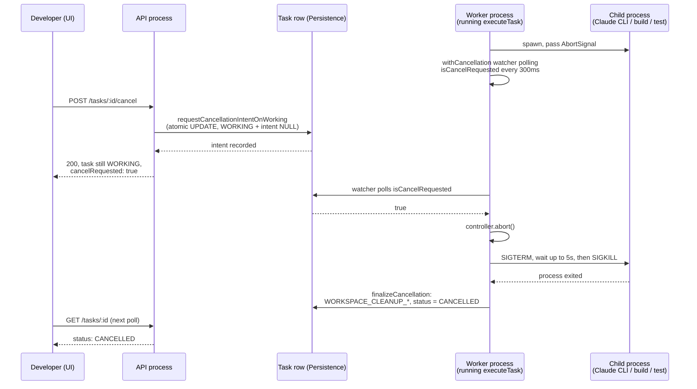

# Task Lifecycle

## States

```
TODO -> WORKING -> REVIEW -> DONE
   \          \-> NEEDS INPUT -> WORKING
    \
     -----------> CANCELLED  (also reachable from WORKING and NEEDS INPUT)
```

- **TODO** — created, not yet picked up by a worker.
- **WORKING** — the Orchestrator is actively driving Implementer/gate/Reviewer steps (see [AGENT_ARCHITECTURE.md](./AGENT_ARCHITECTURE.md)).
- **NEEDS INPUT** — the system stopped because it cannot safely proceed without a human decision. Not a failure state; a controlled pause.
- **REVIEW** — implementation passed all gates and the Reviewer; a report is ready; developer reviews (and, if the project has deployment configured, may approve deployment).
- **DONE** — developer has accepted the result (or, when configured, deployment succeeded and was verified).
- **CANCELLED** — the developer stopped the task before it reached a result. Terminal, and not a failure — see "Cancellation" below.

A task also carries a terminal **FAILED** state, reserved for cases outside the model's control (e.g. repository unreachable, workspace provisioning failure) — distinct from `NEEDS INPUT`, which is reserved for cases requiring a human *decision*, not a human *fix of the platform*, and distinct from `CANCELLED`, which is a deliberate developer decision, not an error of any kind.

## What drives each transition

| Transition | Trigger |
|---|---|
| `TODO -> WORKING` | Worker picks up the task; workspace is provisioned. |
| `WORKING -> NEEDS INPUT` | Implementer reports genuine ambiguity, self-fix loop exhausts its budget, or a gate hard-fails without a safe automatic remedy. |
| `NEEDS INPUT -> WORKING` | Developer submits an answer; Orchestrator re-enqueues with the answer folded into the next invocation's context. |
| `WORKING -> REVIEW` | All configured gates pass and the Reviewer invocation approves. |
| `REVIEW -> DONE` | Developer accepts the result (MVP: manual "accept"; deployment-integrated projects may also require successful, verified deployment). |
| any -> `FAILED` | Platform-level failure unrelated to the model's judgment (infra/provisioning/provider outage). Distinct from `NEEDS INPUT`. |
| `TODO` / `WORKING` / `NEEDS INPUT` -> `CANCELLED` | Developer requests cancellation. See "Cancellation" below for exactly what "requests" means for each of the three. |

The Orchestrator is the only component allowed to write task-state transitions; the Agent Runtime and adapters only report step results (see [ARCHITECTURE.md](./ARCHITECTURE.md#5-task-orchestrator)). Cancellation is no exception: the API/application layer never sets `status` — it calls `Orchestrator.requestCancellation()`, an explicit domain command (see [API.md](./API.md)).

## Cancellation

**Cancellability**: `TODO`, `WORKING`, and `NEEDS_INPUT` can all be cancelled. `REVIEW`, `DONE`, and `FAILED` cannot — attempting to returns `409 INVALID_STATE_TRANSITION` (see [API.md](./API.md)). `CANCELLED` itself is terminal: no transition resumes it, and there is no compelling product reason in this MVP to add one (an accidental cancellation just means creating a new task).

**Why REVIEW/DONE aren't cancellable**: by the time a task reaches REVIEW, execution has already finished — there is nothing running left to *stop*. "I don't want this result" from REVIEW is a different capability (discarding a finished, validated result) than cancellation (interrupting one in progress), and isn't built in this step.

**The core principle governing every race below**: cancellation only preempts work that has **not yet started**; it never retroactively discards a step that has **already completed**. Concretely: the Orchestrator checks for a pending cancellation only at loop boundaries — before starting the next Implementer attempt, before starting validation, before starting the next Reviewer attempt — never in the middle of deciding what a step's own result means. This one rule is what makes every race in the table below deterministic without needing case-by-case logic.

### What "requesting" cancellation actually does

Cancellation is deliberately two different mechanisms depending on whether anything is currently running:

- **TODO / NEEDS_INPUT** — nothing is executing anywhere (TODO hasn't started; NEEDS_INPUT is paused awaiting an answer). `requestCancellation()` finalizes immediately: an atomic, guarded `UPDATE` transitions the task straight to `CANCELLED` and workspace cleanup (if a workspace exists — NEEDS_INPUT tasks resume into an already-provisioned one) runs right there, synchronously with the request.
- **WORKING** — something *might* be executing, possibly in a different OS process (the API and the worker are separate processes — see [TECHNICAL_DECISIONS.md](./TECHNICAL_DECISIONS.md) TD-16 — so the process handling the cancel request cannot simply reach into another process's memory and kill a child process directly). `requestCancellation()` only persists **intent** — `cancel_requested_at`/`cancel_requested_by` on the task row — and returns immediately with the task still `WORKING`. Whichever process is actually driving that task's execution (via `Orchestrator.executeTask()`) is the only thing that can safely finalize it: a lightweight in-process watcher (`withCancellation`, polling every `cancellationPollIntervalMs`, default 300ms) notices the persisted intent and aborts the live `AbortSignal` that every Implementer/Reviewer/validation call was given — see "Process termination" below. If nothing happens to be executing that task at the moment intent is recorded (e.g. between worker poll cycles), the next `executeTask()` call finalizes it immediately via a fast-path check, without starting a fresh Implementer pass first.

This is why a cancelled `WORKING` task briefly shows `cancelRequested: true` while still `WORKING` (the UI shows "Cancelling…") before flipping to `CANCELLED`.

### Race-condition resolution

| Case | Resolution |
|---|---|
| **A** — Cancel clicked while WORKING | Intent recorded; the in-flight execution's watcher aborts it (see above), typically within one `cancellationPollIntervalMs`. |
| **B** — Agent finishes at the same moment Cancel is clicked | If the Implementer's `run()` call had already returned before the watcher's next poll, the loop proceeds to its next boundary check — where it now *does* see the pending intent and stops there, before starting validation. The completed step's result is not discarded; a validation pass that hadn't started yet simply never starts. |
| **C** — Validation finishes while Cancel is requested | Same principle: a validation run in flight finishes normally (its result is used to decide retry-vs-continue as usual); the very next boundary check (before the next Implementer attempt, or before `prepareChanges`) is where cancellation takes effect. |
| **D** — Reviewer finishes (approves) while Cancel is requested | Deliberately **no** boundary check between "Reviewer approved" and transitioning to `REVIEW` (see `runWorkingEpisode`'s comment at that exact point) — a change that has already passed independent review is a real, validated result; cancellation does not retroactively throw it away. The task reaches `REVIEW`, not `CANCELLED`. If the developer still wants to stop there, `REVIEW` isn't cancellable (see above) — the pending `cancel_requested_at` on the (now-REVIEW) task row is simply never consulted again. |
| **E** — Worker claims a TODO task while Cancel arrives | Both `claimTodo` and `finalizeCancellationOnTodo` are guarded, atomic, single-statement `UPDATE`s against the same `status = 'TODO'` precondition — only one can win. If the claim wins, the cancel request retries against the now-`WORKING` task (falls into Case A). If the cancel wins, the claim's `UPDATE` affects zero rows and the worker's `executeTask()` call returns the already-`CANCELLED` task untouched. |
| **F** — Task is already DONE/REVIEW/FAILED when Cancel arrives | Rejected with `409 INVALID_STATE_TRANSITION` — never silently accepted, per the "REVIEW/DONE aren't cancellable" rule above. |
| **G** — Task is NEEDS_INPUT when Cancel is requested | Cancelled immediately (see "TODO / NEEDS_INPUT" above) — there is no live execution to interrupt, and the developer doesn't have to answer a question for a task they no longer want. The (now historical) open `HumanInputRequest` is left as-is, preserved for audit — never deleted. |
| Repeated cancellation of the same task | Idempotent at every stage: already-`CANCELLED` returns as-is; an already-pending intent on a `WORKING` task is not re-recorded (`requestCancellationIntentOnWorking` only fires the `CANCEL_REQUESTED` event the first time). |

### Process termination

The `AbortSignal` from `withCancellation` is threaded through every long-running child process this execution can spawn — the Implementer/Reviewer invocation (`CodingEngine.run()`), and every validation check (build/test/lint/typecheck). On abort, each owns exactly one graceful-then-forced termination policy (`terminateGracefully`, `src/process/terminate-gracefully.ts`, shared by `ClaudeCodeAdapter` and the validation runner): **SIGTERM**, a bounded grace period (5s default), then **SIGKILL** if the process is still alive. Only the specific child process this platform itself spawned for this one invocation is ever signaled — never a PID or process group looked up by name (see [SECURITY_ARCHITECTURE.md](./SECURITY_ARCHITECTURE.md)).

### Workspace cleanup

Once a task is finalized as `CANCELLED`, its isolated task workspace (the disposable clone under `workspaces/<taskId>`, never the developer's actual connected repository) is torn down the same way normal task cleanup would (`WorkspaceProvider.destroy`) — recorded as `WORKSPACE_CLEANUP_STARTED`/`WORKSPACE_CLEANUP_COMPLETED` events. This never removes the audit trail: every `TaskEvent` and `AgentRun` recorded before cancellation stays exactly as it was — that's the evidence of what the task was doing when it was stopped.

### Recovery

A cancellation intent is just another persisted field on the task row, so it survives a crash the same way the rest of task state does (see [TECHNICAL_DECISIONS.md](./TECHNICAL_DECISIONS.md) TD-12): if the worker process dies with a cancellation pending, `recoverOrphanedTasks()` finds the orphaned `WORKING` task exactly as it would for any other crash, and the next `executeTask()` call's fast-path check finalizes the pending cancellation immediately — the task converges to `CANCELLED`, not stuck `WORKING` forever, and not silently resumed as if nothing had been requested.

## Task creation: description → executable task

The developer supplies a short plain-language description. The Orchestrator does not require it to be a technical prompt; the Implementer's own repo investigation (seeded by the project's context files, see [CONTEXT_ARCHITECTURE.md](./CONTEXT_ARCHITECTURE.md)) is what turns "login fails when OTP is entered after session timeout" into a concrete plan. The platform does not run a separate "requirements translation" agent step — that would be exactly the redundant Planner role rejected in [AGENT_ARCHITECTURE.md](./AGENT_ARCHITECTURE.md). The description is stored verbatim as the task's `goal`, and the Implementer's own plan (produced during its first invocation) is persisted as part of the task record so it isn't re-derived on every resume.

## The NEEDS INPUT contract

A `NEEDS INPUT` transition must always carry a structured record, not free text alone:

```
NeedsInputRecord
  discovered: string        # what was found in the codebase/tests
  attempted: string[]       # what was tried
  blocker: string           # precisely why it can't proceed
  question: string          # the specific decision needed
  options: Option[]         # recommended choices, with tradeoffs, where applicable
```

**Rule: the system must never ask for information it can determine itself.** In practice this is enforced by requiring `discovered` and `attempted` to be non-trivial before the Orchestrator accepts a `NEEDS INPUT` report — a report that skips investigation is treated as a defect in the Implementer step, not a valid pause.

Answering does not require the developer to restate context: the Orchestrator builds the next invocation's context bundle from the persisted task record + the new answer, per [CONTEXT_ARCHITECTURE.md](./CONTEXT_ARCHITECTURE.md) — it never replays the full prior transcript.

## Evidence-based completion (the REVIEW gate)

A task cannot reach `REVIEW` on the Implementer's self-report. The gate sequence (project-configurable, see [ARCHITECTURE.md](./ARCHITECTURE.md#12-review--quality-gates)) is:

```
Implementation -> Tests -> Static analysis -> Security checks (if configured)
  -> Independent Reviewer invocation -> Regression validation -> REVIEW
```

Any hard failure routes back to `WORKING` (if the self-fix budget allows another attempt) or to `NEEDS INPUT` (if it doesn't, or if the failure looks like it needs a judgment call rather than another attempt).

**Since Step 7**, reaching `REVIEW` also requires the platform to have committed, pushed, and opened (or idempotently found) a real Pull Request — see [GITHUB_INTEGRATION.md](./GITHUB_INTEGRATION.md) "Commit / push as a real gate" and "Pull Request." A commit, push, or PR-creation failure routes to `FAILED` instead, with whatever evidence was produced before the failure (e.g. a real commit sha even if the push itself failed) preserved on the task record — never a silent skip that lets the task reach `REVIEW` without a real PR behind it. No new `TaskStatus` value was added for this — it's the existing `infra_failure` → `FAILED` transition, same as any other platform-level failure.

## Task report (shown at REVIEW)

```
Task: <title>
What was wrong: <summary>
What changed: <summary>
Files changed: <n>
Tests: <passed>/<total>, <failed> failed
Validation: build <pass/fail>, static checks <pass/fail>, regression <pass/fail>
Confidence: <High|Medium|Low>   # from the Reviewer invocation, not the Implementer
Status: Ready for review | Ready for deployment approval
Pull Request: <url/#number, branch -> base branch>   # since Step 7 — see GITHUB_INTEGRATION.md; absent for local-git projects or before REVIEW
```

Full diffs, logs, and gate output remain available via "View Details," never inline on the board (see [PRODUCT_REQUIREMENTS.md](./PRODUCT_REQUIREMENTS.md)).

## Diagram B — Task execution lifecycle



## Diagram D — Human intervention (NEEDS INPUT) flow



## Diagram E — Cancellation flow (WORKING case)

Note the API process and the worker process are separate (see [TECHNICAL_DECISIONS.md](./TECHNICAL_DECISIONS.md) TD-16) — the request that records intent and the loop that observes it are two different `Orchestrator` instances communicating only through the database, not through shared memory.


