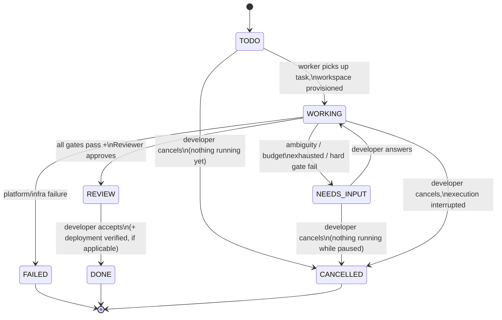
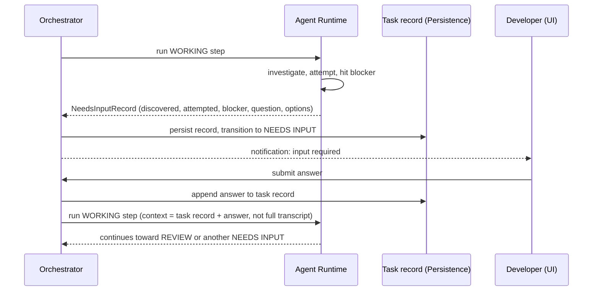
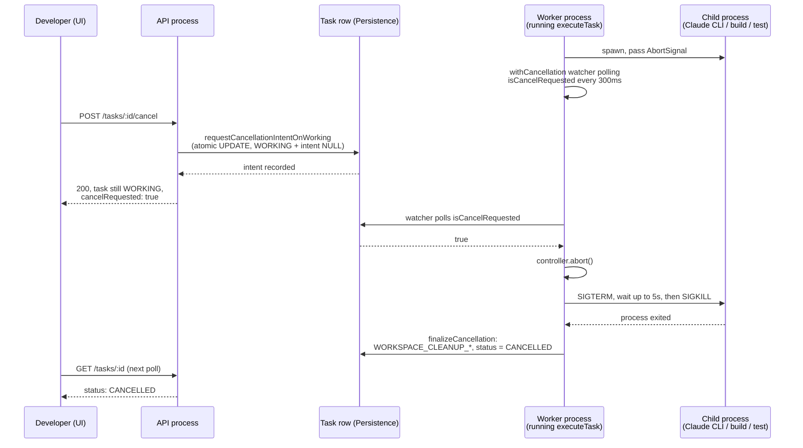

# Task Lifecycle

## States

```
TODO -> WORKING -> REVIEW -> DONE
   \          \-> NEEDS INPUT -> WORKING
    \
     -----------> CANCELLED  (also reachable from WORKING and NEEDS INPUT)
```

- **TODO** — created, not yet picked up by a worker.
- **WORKING** — the Orchestrator is actively driving Implementer/gate/Reviewer steps (see [AGENT_ARCHITECTURE.md](./AGENT_ARCHITECTURE.md)).
- **NEEDS INPUT** — the system stopped because it cannot safely proceed without a human decision. Not a failure state; a controlled pause.
- **REVIEW** — implementation passed all gates and the Reviewer; a report is ready; developer reviews (and, if the project has deployment configured, may approve deployment).
- **DONE** — developer has accepted the result (or, when configured, deployment succeeded and was verified).
- **CANCELLED** — the developer stopped the task before it reached a result. Terminal, and not a failure — see "Cancellation" below.

A task also carries a terminal **FAILED** state, reserved for cases outside the model's control (e.g. repository unreachable, workspace provisioning failure) — distinct from `NEEDS INPUT`, which is reserved for cases requiring a human *decision*, not a human *fix of the platform*, and distinct from `CANCELLED`, which is a deliberate developer decision, not an error of any kind.

## What drives each transition

| Transition | Trigger |
|---|---|
| `TODO -> WORKING` | Worker picks up the task; workspace is provisioned. |
| `WORKING -> NEEDS INPUT` | Implementer reports genuine ambiguity, self-fix loop exhausts its budget, or a gate hard-fails without a safe automatic remedy. |
| `NEEDS INPUT -> WORKING` | Developer submits an answer; Orchestrator re-enqueues with the answer folded into the next invocation's context. |
| `WORKING -> REVIEW` | All configured gates pass and the Reviewer invocation approves. |
| `REVIEW -> DONE` | Developer accepts the result (MVP: manual "accept"; deployment-integrated projects may also require successful, verified deployment). |
| any -> `FAILED` | Platform-level failure unrelated to the model's judgment (infra/provisioning/provider outage). Distinct from `NEEDS INPUT`. |
| `TODO` / `WORKING` / `NEEDS INPUT` -> `CANCELLED` | Developer requests cancellation. See "Cancellation" below for exactly what "requests" means for each of the three. |

The Orchestrator is the only component allowed to write task-state transitions; the Agent Runtime and adapters only report step results (see [ARCHITECTURE.md](./ARCHITECTURE.md#5-task-orchestrator)). Cancellation is no exception: the API/application layer never sets `status` — it calls `Orchestrator.requestCancellation()`, an explicit domain command (see [API.md](./API.md)).

## Cancellation

**Cancellability**: `TODO`, `WORKING`, and `NEEDS_INPUT` can all be cancelled. `REVIEW`, `DONE`, and `FAILED` cannot — attempting to returns `409 INVALID_STATE_TRANSITION` (see [API.md](./API.md)). `CANCELLED` itself is terminal: no transition resumes it, and there is no compelling product reason in this MVP to add one (an accidental cancellation just means creating a new task).

**Why REVIEW/DONE aren't cancellable**: by the time a task reaches REVIEW, execution has already finished — there is nothing running left to *stop*. "I don't want this result" from REVIEW is a different capability (discarding a finished, validated result) than cancellation (interrupting one in progress), and isn't built in this step.

**The core principle governing every race below**: cancellation only preempts work that has **not yet started**; it never retroactively discards a step that has **already completed**. Concretely: the Orchestrator checks for a pending cancellation only at loop boundaries — before starting the next Implementer attempt, before starting validation, before starting the next Reviewer attempt — never in the middle of deciding what a step's own result means. This one rule is what makes every race in the table below deterministic without needing case-by-case logic.

### What "requesting" cancellation actually does

Cancellation is deliberately two different mechanisms depending on whether anything is currently running:

- **TODO / NEEDS_INPUT** — nothing is executing anywhere (TODO hasn't started; NEEDS_INPUT is paused awaiting an answer). `requestCancellation()` finalizes immediately: an atomic, guarded `UPDATE` transitions the task straight to `CANCELLED` and workspace cleanup (if a workspace exists — NEEDS_INPUT tasks resume into an already-provisioned one) runs right there, synchronously with the request.
- **WORKING** — something *might* be executing, possibly in a different OS process (the API and the worker are separate processes — see [TECHNICAL_DECISIONS.md](./TECHNICAL_DECISIONS.md) TD-16 — so the process handling the cancel request cannot simply reach into another process's memory and kill a child process directly). `requestCancellation()` only persists **intent** — `cancel_requested_at`/`cancel_requested_by` on the task row — and returns immediately with the task still `WORKING`. Whichever process is actually driving that task's execution (via `Orchestrator.executeTask()`) is the only thing that can safely finalize it: a lightweight in-process watcher (`withCancellation`, polling every `cancellationPollIntervalMs`, default 300ms) notices the persisted intent and aborts the live `AbortSignal` that every Implementer/Reviewer/validation call was given — see "Process termination" below. If nothing happens to be executing that task at the moment intent is recorded (e.g. between worker poll cycles), the next `executeTask()` call finalizes it immediately via a fast-path check, without starting a fresh Implementer pass first.

This is why a cancelled `WORKING` task briefly shows `cancelRequested: true` while still `WORKING` (the UI shows "Cancelling…") before flipping to `CANCELLED`.

### Race-condition resolution

| Case | Resolution |
|---|---|
| **A** — Cancel clicked while WORKING | Intent recorded; the in-flight execution's watcher aborts it (see above), typically within one `cancellationPollIntervalMs`. |
| **B** — Agent finishes at the same moment Cancel is clicked | If the Implementer's `run()` call had already returned before the watcher's next poll, the loop proceeds to its next boundary check — where it now *does* see the pending intent and stops there, before starting validation. The completed step's result is not discarded; a validation pass that hadn't started yet simply never starts. |
| **C** — Validation finishes while Cancel is requested | Same principle: a validation run in flight finishes normally (its result is used to decide retry-vs-continue as usual); the very next boundary check (before the next Implementer attempt, or before `prepareChanges`) is where cancellation takes effect. |
| **D** — Reviewer finishes (approves) while Cancel is requested | Deliberately **no** boundary check between "Reviewer approved" and transitioning to `REVIEW` (see `runWorkingEpisode`'s comment at that exact point) — a change that has already passed independent review is a real, validated result; cancellation does not retroactively throw it away. The task reaches `REVIEW`, not `CANCELLED`. If the developer still wants to stop there, `REVIEW` isn't cancellable (see above) — the pending `cancel_requested_at` on the (now-REVIEW) task row is simply never consulted again. |
| **E** — Worker claims a TODO task while Cancel arrives | Both `claimTodo` and `finalizeCancellationOnTodo` are guarded, atomic, single-statement `UPDATE`s against the same `status = 'TODO'` precondition — only one can win. If the claim wins, the cancel request retries against the now-`WORKING` task (falls into Case A). If the cancel wins, the claim's `UPDATE` affects zero rows and the worker's `executeTask()` call returns the already-`CANCELLED` task untouched. |
| **F** — Task is already DONE/REVIEW/FAILED when Cancel arrives | Rejected with `409 INVALID_STATE_TRANSITION` — never silently accepted, per the "REVIEW/DONE aren't cancellable" rule above. |
| **G** — Task is NEEDS_INPUT when Cancel is requested | Cancelled immediately (see "TODO / NEEDS_INPUT" above) — there is no live execution to interrupt, and the developer doesn't have to answer a question for a task they no longer want. The (now historical) open `HumanInputRequest` is left as-is, preserved for audit — never deleted. |
| Repeated cancellation of the same task | Idempotent at every stage: already-`CANCELLED` returns as-is; an already-pending intent on a `WORKING` task is not re-recorded (`requestCancellationIntentOnWorking` only fires the `CANCEL_REQUESTED` event the first time). |

### Process termination

The `AbortSignal` from `withCancellation` is threaded through every long-running child process this execution can spawn — the Implementer/Reviewer invocation (`CodingEngine.run()`), and every validation check (build/test/lint/typecheck). On abort, each owns exactly one graceful-then-forced termination policy (`terminateGracefully`, `src/process/terminate-gracefully.ts`, shared by `ClaudeCodeAdapter` and the validation runner): **SIGTERM**, a bounded grace period (5s default), then **SIGKILL** if the process is still alive. Only the specific child process this platform itself spawned for this one invocation is ever signaled — never a PID or process group looked up by name (see [SECURITY_ARCHITECTURE.md](./SECURITY_ARCHITECTURE.md)).

### Workspace cleanup

Once a task is finalized as `CANCELLED`, its isolated task workspace (the disposable clone under `workspaces/<taskId>`, never the developer's actual connected repository) is torn down the same way normal task cleanup would (`WorkspaceProvider.destroy`) — recorded as `WORKSPACE_CLEANUP_STARTED`/`WORKSPACE_CLEANUP_COMPLETED` events. This never removes the audit trail: every `TaskEvent` and `AgentRun` recorded before cancellation stays exactly as it was — that's the evidence of what the task was doing when it was stopped.

### Recovery

A cancellation intent is just another persisted field on the task row, so it survives a crash the same way the rest of task state does (see [TECHNICAL_DECISIONS.md](./TECHNICAL_DECISIONS.md) TD-12): if the worker process dies with a cancellation pending, `recoverOrphanedTasks()` finds the orphaned `WORKING` task exactly as it would for any other crash, and the next `executeTask()` call's fast-path check finalizes the pending cancellation immediately — the task converges to `CANCELLED`, not stuck `WORKING` forever, and not silently resumed as if nothing had been requested. See "Crash recovery" below for the general mechanism this relies on.

## Crash recovery

Every `WORKING` task's state — `branchName`, `pullRequest`, `selfFixAttempts`, `pendingHumanReviewFeedback`, every `TaskEvent`, every `AgentRun` — is a normal database row, written before (or as part of) the step it describes, never held only in a process's memory. This is what makes recovery possible at all: nothing needs to be reconstructed from a transcript, because nothing important only ever existed in memory.

**Detecting a crash.** A worker/API process holds a task via a leased claim (`TaskRepository.claimTodo`/`claimWorking`, `lock_owner` + `lock_expires_at` — see TECHNICAL_DECISIONS.md TD-12). While a live execution is genuinely still running, `Orchestrator.withCancellation` renews that lease periodically (`leaseHeartbeatIntervalMs`, well below `taskLeaseMs`) — an episode spanning multiple self-fix/review cycles can easily outlast `taskLeaseMs` on its own, and without renewal that would look identical to a crash. Once the lease is no longer renewed (the process that held it is gone), it simply expires; `Worker.tick()` calls `recoverOrphanedTasks()` every poll, which finds `WORKING` tasks past their lease and marks any `AgentRun` still `"running"` as `"interrupted"` — evidence, not a status the task itself ever shows. The task row itself is untouched: still `WORKING`, its lease now expired, so any process's next `claimWorking` call can win it.

**Resuming.** Recovery is coarse-grained, not a fine-grained "resume exactly where it stopped": a re-claimed `WORKING` task re-enters the same top-level function it would have for its trigger — `runWorkingEpisode` (claimed from `TODO`, or via the AI reviewer's own internal fix loop) or `runHumanFeedbackFixCycle` (claimed via a human's GitHub review — see "Human review feedback loop" and below). Whatever already-completed work exists (a provisioned workspace, a passing validation run, a pushed commit, an opened PR) is *reused*, never redone from scratch — each of those steps checks its own persisted evidence first:

- **Workspace/branch**: `provisionWorkspace` checks `WorkspaceRepository.findByTaskId` before calling the provider at all — a `"ready"` workspace is returned as-is, with no `WORKSPACE_CREATED`/`BRANCH_CREATED` event re-emitted (these are one-time creation events; re-entering the function isn't a second creation). A `WorkspaceProvider.provision()` call always clones to the same deterministic `<workspacesRoot>/<taskId>` path regardless of how many times it's invoked.
- **PR**: `ensurePullRequest`'s existing short-circuit on `taskRecord.pullRequest` (see "Evidence-based completion") applies exactly the same way on a recovery re-entry as on any other retry.
- **Commit/push**: `commitAllLocal` is itself a no-op (returns the current `HEAD`, no error) when there's nothing new to commit — see [GITHUB_INTEGRATION.md](./GITHUB_INTEGRATION.md) — so a redundant re-run of `prepareChanges` after a crash is harmless, not an error.
- **AgentRun attemptNumber**: derived from `agentRunRepo.listForTask(taskId).filter(role).length + 1` (`Orchestrator.nextAttemptNumber`) — a count of real persisted rows, including interrupted ones — rather than a separately-tracked counter that only advances at certain checkpoints. This is what guarantees a recovered attempt never collides with the interrupted one it's replacing: the interrupted row's own existence is what pushes the next number up, regardless of exactly when the crash happened.
- **Human review feedback fix cycle**: this is the one recovery path needing an explicit marker, because it's a genuinely different function than the original pipeline and `executeTask` has to know *which* one to resume. `TaskRecord.pendingHumanReviewFeedback` is set (persisted, before any work starts) the moment the cycle is claimed, and cleared (also persisted) the moment it ends (success, `NEEDS_INPUT`, or failure) — `executeTask`'s dispatch checks it on every `WORKING` claim: if set, resume `runHumanFeedbackFixCycle` (which itself reads the feedback back out of the same field, not a parameter); if not, resume the original `runWorkingEpisode`. The one-time `HUMAN_REVIEW_CHANGES_REQUESTED` trigger event is emitted by the *caller* (`checkHumanReviewFeedback`), not by `runHumanFeedbackFixCycle` itself, specifically so a recovery re-entry into the fix cycle never re-emits it.

**What "coarse-grained" costs.** A crash during, say, the AI Reviewer's own invocation causes the *whole* episode to restart from the top on recovery — the self-fix loop's Implementer runs again too, even though it had already succeeded. This produces extra `AgentRun` rows and (harmless, idempotent) repeated `COMMIT_CREATED`/`BRANCH_PUSHED` events. This is a deliberate simplification, not an oversight: the platform's own stated invariant is "one workspace, one branch, one PR — multiple AgentRuns/commits are allowed" (see [ARCHITECTURE.md](./ARCHITECTURE.md)), and redoing bounded, cheap, idempotent work is a simpler and more robust recovery model than threading fine-grained "resume point" state through every step of `runWorkingEpisode`. The one case worth the extra precision is the human review feedback fix cycle, precisely because getting it wrong there doesn't just waste an attempt — it silently runs the *original* pipeline logic (no reviewer feedback in context, then wrongly re-invokes the AI Reviewer) instead of the fix the human actually asked for.

**Cancellation still works after a restart.** A recovered `WORKING` task goes through the exact same `Orchestrator.executeTask` → `withCancellation` path as any other execution, so `requestCancellation` and the fast-path/mid-episode checks described above apply identically, regardless of which process (or how many crashes) got the task to this point.

**A genuine in-process exception** (a bug, not a crash) is a different, already-narrower case: it's caught by `executeTask`'s own `try/catch`, which fails the task cleanly (`FAILED`, `TASK_FAILED`) and releases the lock in a `finally` — never left `WORKING` with no live process behind it.

## Task creation: description → executable task

The developer supplies a short plain-language description. The Orchestrator does not require it to be a technical prompt; the Implementer's own repo investigation (seeded by the project's context files, see [CONTEXT_ARCHITECTURE.md](./CONTEXT_ARCHITECTURE.md)) is what turns "login fails when OTP is entered after session timeout" into a concrete plan. The platform does not run a separate "requirements translation" agent step — that would be exactly the redundant Planner role rejected in [AGENT_ARCHITECTURE.md](./AGENT_ARCHITECTURE.md). The description is stored verbatim as the task's `goal`, and the Implementer's own plan (produced during its first invocation) is persisted as part of the task record so it isn't re-derived on every resume.

## The NEEDS INPUT contract

A `NEEDS INPUT` transition must always carry a structured record, not free text alone:

```
NeedsInputRecord
  discovered: string        # what was found in the codebase/tests
  attempted: string[]       # what was tried
  blocker: string           # precisely why it can't proceed
  question: string          # the specific decision needed
  options: Option[]         # recommended choices, with tradeoffs, where applicable
```

**Rule: the system must never ask for information it can determine itself.** In practice this is enforced by requiring `discovered` and `attempted` to be non-trivial before the Orchestrator accepts a `NEEDS INPUT` report — a report that skips investigation is treated as a defect in the Implementer step, not a valid pause.

Answering does not require the developer to restate context: the Orchestrator builds the next invocation's context bundle from the persisted task record + the new answer, per [CONTEXT_ARCHITECTURE.md](./CONTEXT_ARCHITECTURE.md) — it never replays the full prior transcript.

## Evidence-based completion (the REVIEW gate)

A task cannot reach `REVIEW` on the Implementer's self-report. The gate sequence (project-configurable, see [ARCHITECTURE.md](./ARCHITECTURE.md#12-review--quality-gates)) is:

```
Implementation -> Tests -> Static analysis -> Security checks (if configured)
  -> Independent Reviewer invocation -> Regression validation -> REVIEW
```

Any hard failure routes back to `WORKING` (if the self-fix budget allows another attempt) or to `NEEDS INPUT` (if it doesn't, or if the failure looks like it needs a judgment call rather than another attempt).

**Since Step 7**, reaching `REVIEW` also requires the platform to have committed, pushed, and opened (or idempotently found) a real Pull Request — see [GITHUB_INTEGRATION.md](./GITHUB_INTEGRATION.md) "Commit / push as a real gate" and "Pull Request." A commit, push, or PR-creation failure routes to `FAILED` instead, with whatever evidence was produced before the failure (e.g. a real commit sha even if the push itself failed) preserved on the task record — never a silent skip that lets the task reach `REVIEW` without a real PR behind it. No new `TaskStatus` value was added for this — it's the existing `infra_failure` → `FAILED` transition, same as any other platform-level failure.

### Review/fix cycle

"Independent Reviewer invocation" above is not a single pass — a rejection ("changes requested") triggers a bounded self-correction loop, all still inside the single `WORKING` episode (no new `TaskStatus`, matching the state machine's existing "internal execution steps are tracked via AgentRun + TaskEvent, not additional Task states" principle):

```
Implementer -> Validation -> Commit -> Push
  -> Reviewer
       |-- APPROVED -> Pull Request (opened/reused) -> REVIEW
       `-- CHANGES_REQUESTED -> Implementer (fix, same workspace/branch) -> Validation -> Commit -> Push -> Reviewer (again)
```

- **Same workspace, same branch, one PR, always.** The workspace and branch are provisioned exactly once per task, *before* this loop starts — a rejection re-runs only the Implementer, validation, and commit/push, never re-provisions anything. The PR is opened exactly once, only after an `APPROVED` verdict (idempotency guard: `Orchestrator.ensurePullRequest`'s own short-circuit on an already-recorded `taskRecord.pullRequest`, plus the `SourceControlProvider`'s own search-before-create — see [GITHUB_INTEGRATION.md](./GITHUB_INTEGRATION.md) "PR idempotency").
- **Reviewer findings reach the fix pass as structured feedback**, not a replayed transcript: the Implementer's `ContextBundle` gets a `reviewerFeedback: ReviewResult` (verdict, findings, the Reviewer's own summary) instead of the self-fix loop's `lastFailure` — a review-triggered fix always follows a *passing* validation run, so there's no validation failure to report alongside it. `buildImplementerPrompt` renders this as an explicit "Reviewer verdict / Reviewer findings / Instructions" block — see `src/coding-engine/prompt-builder.ts`.
- **Verdict detection**: real models overwhelmingly answer in prose, not a structured findings array — `buildReviewerPrompt` asks for an explicit closing `VERDICT: APPROVED` / `VERDICT: CHANGES_REQUESTED` line (with `FINDING:` lines above it when rejecting), and `deriveReviewResult` (`src/review/reviewer.ts`) parses it. An explicit verdict line always wins over the older completed-status heuristic, which remains the fallback for any engine/test double that doesn't emit one. Verified live: a real Gemini reviewer rejected a task citing a specific missing file, the Implementer's fix addressed exactly that finding, and the Reviewer approved on the second pass — same workspace, same branch, one PR.
- **Bounded, not infinite**: `OrchestratorConfig.maxReviewerRejections` (default 2, same config knob used since Step 2 — no new configuration mechanism was introduced) caps the number of fix cycles. Exhausting it **fails the task** (`FAILED`, via the same `infra_failure` transition and `TASK_FAILED` event every other platform-level failure already uses) with a clear reason built from the last Reviewer's real findings — deliberately not `NEEDS_INPUT`: a Reviewer that keeps finding new issues within a bounded retry budget is a concrete, evidence-backed failure to report, not an open-ended question. See TECHNICAL_DECISIONS.md.
- **Observability**: `REVIEW_STARTED` fires before every Reviewer attempt (including retries — distinguishable via its `attemptNumber` and the AgentRun's own `attemptNumber`); a rejection emits `REVIEW_CHANGES_REQUESTED` (carrying the findings) before the fix Implementer starts, so the event log alone shows exactly when and why a cycle repeated.
- **Cancellation**: the same `AbortSignal`/checkpoint model as everywhere else in `WORKING` (see "Cancellation" above) — checked before each Reviewer attempt, before the transition into a fix pass, and inside every step the fix pass itself runs (Implementer invocation, validation, commit, push). A cancellation mid-cycle interrupts cleanly into `CANCELLED`; it never lets the loop continue into another cycle.

### Human review feedback loop

Reaching `REVIEW` is not the end of the story if the connected repository is a real GitHub project: a human reviewer working the actual Pull Request can request changes, and the platform resumes the *same* task from that feedback — without a human ever having to reopen this app. This reuses transitions the state machine already had (`REVIEW --changes_requested--> WORKING`, `WORKING --gates_passed--> REVIEW`) but had no caller for until now:

```
REVIEW -> (poll finds a "changes requested" PR review) -> HUMAN_REVIEW_CHANGES_REQUESTED
  -> Implementer (fix, same workspace/branch) -> Validation -> Commit -> Push -> REVIEW
```

- **Source of feedback**: `SourceControlProvider.listPullRequestFeedback` — a minimal read of the PR's submitted reviews (verdict + body) and conversation comments, not a general GitHub API framework. `local-git` (the dev/test fixture provider) always returns `[]`; only `github` reads anything real. See [GITHUB_INTEGRATION.md](./GITHUB_INTEGRATION.md) "Human review feedback ingestion".
- **What's actionable**: only a submitted review with GitHub's `CHANGES_REQUESTED` state triggers a fix cycle, and only on a PR that's still `open` — a merged or closed PR's feedback is never fetched at all (checked first, via a single-PR state read), so a later worker poll can never re-trigger implementation because of a stray or late review on a PR that's already merged/closed. Approvals and plain comments are recorded (so a repeat poll doesn't re-detect them) but change nothing — the task stays `REVIEW`, and the platform never auto-merges or invents a new terminal state on an approval or a merge. See [GITHUB_INTEGRATION.md](./GITHUB_INTEGRATION.md) "PR state handling".
- **Driven by polling, not a webhook**: the same `Worker` that polls `TODO`/`WORKING` tasks also polls `REVIEW` tasks and calls `Orchestrator.checkHumanReviewFeedback` for each — a no-op unless there's new feedback. `POST /tasks/:taskId/check-review-feedback` exposes the same operation on demand instead of waiting for the next poll tick.
- **Same workspace, same branch, one PR — still.** `checkHumanReviewFeedback` never re-provisions anything; it claims the existing task (`TaskRepository.claimReviewForHumanFeedback`, the same atomic-`UPDATE`-with-`WHERE`-guard pattern as `claimTodo`) and runs the Implementer/validation/commit/push directly against the workspace and branch already on the task record. Pushing new commits to the same branch is what "updates" the existing PR — no PR-update API call is made or needed.
- **Feedback reaches the Implementer as an explicit, distinguishable block** — a `ContextBundle.humanReviewFeedback` field (reviewer login + comments), never merged into `priorDecisions` or the AI Reviewer's own `reviewerFeedback`. `buildImplementerPrompt` renders it as a "Human reviewer feedback" block (`Reviewer:` / `Review:` / `Comments:` / `Requested changes:`) so the Implementer can tell apart the original task, the AI Reviewer's feedback, a human's GitHub feedback, and a plain validation failure.
- **Idempotency**: every feedback item's id (`review:<n>` / `comment:<n>`) is recorded in `TaskRecord.processedHumanFeedbackIds` *before* the fix cycle runs, and a repeated poll only ever looks at items not already in that set — a review GitHub still reports on a later poll never triggers a second fix cycle.
- **Observability**: `HUMAN_REVIEW_DETECTED` (new feedback found), `HUMAN_REVIEW_APPROVED` (an approval, informational only), and `HUMAN_REVIEW_CHANGES_REQUESTED` (the actionable trigger) are the only new event types. Everything else in the cycle reuses existing events (`AGENT_STARTED`/`AGENT_COMPLETED`, `VALIDATION_STARTED`/`VALIDATION_COMPLETED`, `COMMIT_CREATED`, `BRANCH_PUSHED`, `TASK_MOVED_TO_REVIEW`).
- **No independent AI review step in this loop** — unlike the AI review/fix cycle above, a human-feedback fix pass goes straight back to `REVIEW` after a passing validation run. The human who requested the change is the one who reviews the result again, on GitHub.
- **Cancellation**: the human-feedback fix cycle runs the task through `WORKING` exactly like any other episode, so it gets the exact same cancellation mechanism for free (`Orchestrator.withCancellation`, the same `AbortSignal`/checkpoint model) — checked before the fix pass starts, inside the Implementer invocation, during validation, and before returning to `REVIEW`. A cancellation mid-cycle lands in `CANCELLED`, never continues into another poll.

## Task report (shown at REVIEW)

```
Task: <title>
What was wrong: <summary>
What changed: <summary>
Files changed: <n>
Tests: <passed>/<total>, <failed> failed
Validation: build <pass/fail>, static checks <pass/fail>, regression <pass/fail>
Confidence: <High|Medium|Low>   # from the Reviewer invocation, not the Implementer
Status: Ready for review | Ready for deployment approval
Pull Request: <url/#number, branch -> base branch>   # since Step 7 — see GITHUB_INTEGRATION.md; absent for local-git projects or before REVIEW
```

Full diffs, logs, and gate output remain available via "View Details," never inline on the board (see [PRODUCT_REQUIREMENTS.md](./PRODUCT_REQUIREMENTS.md)).

## Execution history and observability

The Task Detail UI/API exposes a fuller execution history than the concise report above — every `AgentRun`, a duration breakdown, and richer failure/recovery context. This is deliberately a second *view* over the exact same `AgentRun`/`TaskEvent` rows everything else in this document already describes, not a second parallel event/history system: `src/reporting/execution-history.ts` is a set of pure functions that read existing persisted evidence and derive a presentation-friendly shape, wired into the existing `GET /tasks/:taskId/report` response (see [API.md](./API.md)) rather than a new endpoint.

- **Agent run history** (`TaskReport.agentRuns`): every `AgentRun`, in order, each with a derived `trigger` — `"initial"` (the first Implementer pass), `"self_fix_retry"` (a validation-failure retry — `ContextBundle.lastFailure` was set), `"ai_review_fix"` (the AI Reviewer rejected — `reviewerFeedback` was set), `"human_review_fix"` (a human's GitHub review requested changes — `humanReviewFeedback` was set), or `"review"` (any Reviewer-role run). All four of these signals already existed on the persisted `ContextBundle`; this only reads them back out. A Reviewer run's `verdict` is derived with the exact same `deriveReviewResult()` the Orchestrator itself uses to decide `APPROVED`/`CHANGES_REQUESTED` — never a second, possibly-inconsistent verdict concept.
- **Crash recovery visibility** (`resumedAfterInterruption` per run, `recoveredFromCrash` on the report): a run is "resumed after an interruption" iff the immediately preceding `AgentRun` of the same role has `status: "interrupted"` — the exact status `recoverOrphanedTasks()` already sets on a crash-orphaned run (see "Crash recovery" above). No new event or flag was added to detect this; it's a direct read of that existing status.
- **Durations** (`TaskReport.durations`): `totalMs` (Task.startedAt → completedAt), `implementationMs`/`reviewMs` (summed across every Implementer/Reviewer `AgentRun`'s own startedAt/completedAt), `validationMs` (every paired `VALIDATION_STARTED`/`VALIDATION_COMPLETED` event), `waitingForHumanReviewMs` (the most recent `TASK_MOVED_TO_REVIEW` event to whichever comes first: a human-response event, or the task's own `completedAt`). Every value is `null`, never estimated, when its boundary timestamps aren't both available yet — no new field is persisted; everything is computed from timestamps that already exist.
- **Failure visibility** (`TaskReport.failureContext`, FAILED tasks only): which stage failed (derived from the last relevant event — `AGENT_FAILED`, `SOURCE_CONTROL_FAILED`, `WORKSPACE_FAILED`, or `REVIEW_CHANGES_REQUESTED` — immediately before the `TASK_FAILED` event), which role and attempt number (the last `AgentRun` with status `"failed"` or `"interrupted"`), and whether the task's history includes any crash-recovery resume at all. `AgentRun.error` (a sanitized, already-concise message — never a raw stack trace, see its own persistence contract in orchestrator.ts) is surfaced per-run behind an expandable "Technical error details" element in the UI, not inline by default.
- **Frontend**: `ActivityTimeline` now renders a short detail line per event, extracted from that event's own existing `payload` (see `web/src/lib/eventDetail.ts`) — e.g. "Implementer · attempt 2" for `AGENT_STARTED`, "1/2 checks passed" for `VALIDATION_COMPLETED`. `AgentRunHistory` and `DurationStats` are new, focused components; `ReportPanel` gained a "Recovered from a crash" banner (only when `recoveredFromCrash`) and an expandable "Execution details" section — no redesign of the existing page structure.

## Diagram B — Task execution lifecycle



## Diagram D — Human intervention (NEEDS INPUT) flow



## Diagram E — Cancellation flow (WORKING case)

Note the API process and the worker process are separate (see [TECHNICAL_DECISIONS.md](./TECHNICAL_DECISIONS.md) TD-16) — the request that records intent and the loop that observes it are two different `Orchestrator` instances communicating only through the database, not through shared memory.


